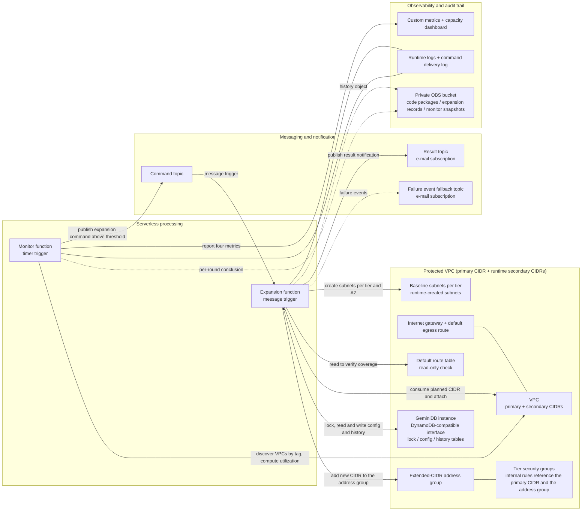

# Automated VPC Address Capacity Expansion on Huawei Cloud

[](LICENSE)
[](https://www.huaweicloud.com)

## Overview

This practice builds a closed loop on Huawei Cloud: **capacity inspection -> expansion command when the
threshold is reached -> automatic extension of CIDR blocks and subnets -> result notification and
audit trail**. New address space is added to a VPC before the existing one runs out.

Manual VPC address management usually fails in three ways. Nobody recomputes how many addresses are left,
so exhaustion is discovered when a workload reports "cannot create an instance"; after a secondary CIDR is
attached, subnets still have to be created tier by tier and every security group has to learn the new
address range, which is a long checklist with room for mistakes; and expansion is a write operation, so
two concurrent runs can corrupt the same address space. Two serverless functions replace that workflow:

1. **Capacity visibility.** The monitor function discovers tag-managed VPCs, reads the primary CIDR, the
   attached secondary CIDRs and every subnet, and reports four custom metrics — address utilization,
   available addresses, total capacity and subnet count — into a custom namespace wired to a dashboard.
2. **Plan-driven expansion.** Once utilization reaches the trigger line, the monitor function publishes an
   expansion command to a topic. The expansion function consumes it, checks whether the existing address
   space can host a full tier rollout, and only then takes the next block from the configured CIDR plan
   after an overlap check, attaches it to the VPC and creates subnets per tier in every availability zone.
3. **Reachable as soon as it is created.** Huawei Cloud security groups bind to ports, not to subnets, so
   this practice points each tier security group's internal traffic rule at one address group: adding the
   new CIDR to that group makes it effective for every tier at once. The default route table is used as a
   read-only coverage check.
4. **Serialized per VPC.** The expansion function takes a per-VPC lock with an expiry time in the state
   tables, and combined with a concurrency limit of 1 and a publishing cooldown it guarantees that only one
   expansion ever runs against a given VPC at a time.
5. **Traceable results.** Each execution writes one authoritative row to the history table, publishes a
   notification listing the name, CIDR, availability zone and ID of every created subnet, and stores a
   readable snapshot object in object storage.

Intended for:

- Network and application operators who maintain several VPCs on Huawei Cloud and want address expansion to
  stop being a manual procedure;
- Teams that want one Terraform stack producing an observable, reproducible and destroyable automation
  chain, without keeping an always-on orchestration service around;
- Readers looking for a reference implementation of the shape "scheduled inspection + message-triggered
  execution + in-function polling + distributed lock + dual-write audit trail".

## Table of Contents

- [Repository layout](#repository-layout)
- [Architecture](#architecture)
- [Highlights](#highlights)
- [Huawei Cloud services](#huawei-cloud-services)
- [Prerequisites](#prerequisites)
- [Quick start](#quick-start)
- [Step-by-step deployment](#step-by-step-deployment)
- [Parameters](#parameters)
- [Usage and verification](#usage-and-verification)
- [Clean up resources](#clean-up-resources)
- [Further reading](#further-reading)
- [Troubleshooting](#troubleshooting)
- [License](#license)
- [Contact](#contact)

## Repository layout

```text
.
├── docs/
│   ├── architecture.md              Components, data flow, CIDR and tier planning model, locking and idempotency, failure semantics, trade-offs
│   └── deployment-guide.md          Step-by-step commands from an empty directory to a verified deployment, with expected output for each step
├── infra/
│   ├── versions.tf                  Terraform and provider version constraints
│   ├── providers.tf                 Provider configuration
│   ├── variables.tf                 Deployment variables and validation (63 in total)
│   ├── locals.tf                    Tier discovery, runtime settings for both functions, metric and dashboard inventory
│   ├── vpc.tf                       The protected VPC, baseline subnets, public egress, state store instance
│   ├── network.tf                   Default route table reference, extended-CIDR address group, tier security groups and rules
│   ├── functions.tf                 Code package bucket, the two functions, two kinds of trigger, async failure fallback
│   ├── monitoring.tf                Three topics, two e-mail subscriptions, address capacity dashboard
│   ├── lts.tf                       Log group, three log streams, command delivery log
│   ├── iam.tf                       Runtime agency for the functions, customer-managed encryption key
│   ├── outputs.tf                   Outputs
│   └── terraform.tfvars.example     Sample values (placeholders only)
├── src/
│   └── functions/
│       ├── shared/                  Modules shared by both functions
│       │   ├── net_plan.py          CIDR geometry, free-block allocation, name sequence, utilization definition
│       │   ├── state_store.py       State store client: table creation and the three access patterns
│       │   ├── ddb_signer.py        Request signing for the state store interface
│       │   ├── hw_cloud_api.py      Single entry point for network and messaging reads and writes
│       │   ├── hw_signer.py         Request signing for cloud service APIs
│       │   ├── hw_transport.py      Transport with timeouts and a retry ceiling
│       │   ├── history_writer.py    Writes the history row and the object snapshot
│       │   ├── invocation.py        Event envelope unwrapping, runtime credentials, execution ID
│       │   └── handler_errors.py    Error layering (decides whether a retry is worth it)
│       ├── monitor/                 Monitor function
│       │   ├── index.py             Entry point and orchestration of one inspection round
│       │   ├── monitor_conf.py      Runtime settings and threshold constraints
│       │   ├── inspector.py         Tag-based VPC discovery, observed values, plan view
│       │   ├── metrics.py           Assembly and chunked reporting of the four custom metrics
│       │   ├── dispatcher.py        Publish decision, observation write-back, publishing cooldown
│       │   └── snapshot.py          Snapshot object for one inspection round
│       ├── expansion/               Expansion function
│       │   ├── index.py             Entry point: assembly, lock acquisition, finish (release -> notify -> raise)
│       │   ├── runtime_conf.py      Runtime settings and tier planning objects
│       │   ├── expansion_flow.py    The sequential body of one expansion
│       │   ├── expansion_lock.py    Per-VPC distributed lock (acquire, check, release)
│       │   └── notify_text.py       Notification subject and body text
│       ├── build_packages.py        Code package builder (two packages, flattened to the zip root)
│       ├── build/                   Build output directory (created by the builder script)
│       └── tests/                   Offline unit tests (395 cases, all cloud interaction handled by fakes)
├── .gitignore
├── README.md
├── README.en.md
└── LICENSE
```

## Architecture



The data flow has six stages, each mapped to code in this repository:

| Stage | Implementation | What happens |
|-|-|-|
| Discovery and observation | `src/functions/monitor/inspector.py` | Lists VPCs in the project, keeps those tagged `MonitorCIDR=true`; derives utilization, available addresses, total capacity and subnet count from primary plus secondary CIDRs and the remaining capacity of each subnet |
| Metrics and dashboard | `src/functions/monitor/metrics.py`, `infra/locals.tf`, `infra/monitoring.tf` | Four series reported to the custom namespace `vpc_cidr_expansion.custom` under the dimension name `VpcId`; the dashboard reads the same namespace and metric names |
| Trigger decision | `src/functions/monitor/dispatcher.py` | Publishes `{vpc_id, reason, utilization}` to the command topic when utilization reaches the trigger line, the CIDR plan is not exhausted and no command was published for this VPC within the last 1800 seconds |
| Address expansion | `src/functions/expansion/expansion_flow.py`, `src/functions/shared/net_plan.py` | Checks whether existing space is sufficient; if not, consumes the next planned block, polls until it is attached, then carves free blocks into subnets per tier in every availability zone |
| CIDR linkage | `infra/network.tf`, `expansion_flow._ensure_address_group` | The new CIDR is written to the address group, so every tier security group's inbound rule covering that group applies to the new address space immediately; the default route table is verified read-only |
| Serialization and audit trail | `expansion_lock.py`, `history_writer.py`, `notify_text.py`, `infra/monitoring.tf` | Per-VPC lock acquisition and release, one history row per execution, one snapshot object in the bucket, one notification on the result topic |

## Highlights

- **Threshold logic lives in code, not in operator experience.** The trigger line (85% by default) and the
  lower bound re-checked on the expansion side (80% by default) are delivered explicitly as deployment
  variables, and both functions share one utilization definition (3 reserved addresses deducted per subnet),
  so a single chain never produces two different "utilizations".
- **Plan-driven CIDR consumption.** Secondary CIDRs come from `planned_secondary_cidrs`, an externally
  provided ordered plan. Each candidate is checked against the primary CIDR, the already attached CIDRs and
  existing subnets before it is consumed, and skipped entries are recorded together with the reason.
- **One invocation runs the whole chain.** Lock acquisition -> CIDR attachment -> polling until effective ->
  subnet creation -> CIDR linkage -> history write -> notification -> lock release all happen inside a single
  expansion invocation. Every branch and wait is written explicitly in code; no always-on orchestrator needed.
- **Writes are never blindly re-issued.** After a timeout the outcome of a CIDR attachment or subnet creation is
  unknown, so the function first reads back the real state (poll the attachment, confirm by name whether the
  subnet already exists) before deciding what to do next. That avoids "the same CIDR attached twice" and
  "duplicate subnets with the same name".
- **One shared retry budget for the whole subnet phase.** Attempts and interval (3 x 30 seconds by default)
  produce a budget shared by the whole subnet creation phase rather than one per subnet; when it is exhausted
  the function stops waiting and records the remaining subnets as failed, so the chain always delivers a usable
  part plus a complete history row.
- **Serialized per VPC.** The expansion function's concurrency limit is 1, backed by a conditional-write lock
  per VPC in the state table and holder-verified release. Duplicate publishing, manual publishing and async
  redelivery all result in exactly one real expansion.
- **Reachable as soon as it is created.** Each tier security group's internal traffic rule references one
  address group, so a new CIDR entering that group is effective for every tier at once. Under the Huawei Cloud
  constraint of one route table per VPC by default, CIDR routes are maintained by the platform and only read
  back for verification.
- **Runtime state is not reverted by deployment.** Five fields — attached secondary CIDRs, address group
  membership, the default route's next hop, baseline subnet tags, and the timer's schedule and enabled flag —
  defer to what the platform or the functions did at runtime, so a later `terraform apply` will not undo those
  changes.
- **Failures are not silent.** When a function execution fails, the platform's async invocation settings
  deliver the event to the fallback topic and notify by e-mail; a history row that could not be written, a
  notification that could not be published, or a lock that could not be released is stated explicitly in the
  result and in the logs.
- **Verifiable offline.** 395 unit tests need no network and exercise every decision branch of the chain before
  you deploy; the builder script uses the standard library only.

## Huawei Cloud services

| Service | Role in this practice | Resources |
|-|-|-|
| Virtual Private Cloud VPC | The protected and expanded network: primary CIDR, runtime secondary CIDRs, management tag | `huaweicloud_vpc` |
| VPC subnet | Baseline subnets per tier; subnets created by the expansion function at runtime are not part of this stack | `huaweicloud_vpc_subnet` |
| VPC route | Default route table (read-only data source reference) and the default egress route for the `public` tier | `huaweicloud_vpc_route`, `data.huaweicloud_vpc_route_table` |
| Internet gateway | The VPC's public egress device, declared separately from the default route | `huaweicloud_vpc_internet_gateway` |
| Address group | The set of extended CIDR blocks; the only mutable set referenced by security group rules | `huaweicloud_vpc_address_group` |
| Security group | One group per tier; inbound rules reference the primary CIDR and the address group | `huaweicloud_networking_secgroup`, `huaweicloud_networking_secgroup_rule` |
| GeminiDB (DynamoDB-compatible interface) | State store for the lock, per-VPC configuration and expansion history tables; tables created by the functions on first use | `huaweicloud_geminidb_instance` |
| FunctionGraph | Monitor and expansion functions, timer and message triggers, async failure fallback | `huaweicloud_fgs_function`, `huaweicloud_fgs_trigger`, `huaweicloud_fgs_async_invoke_configuration` |
| Object Storage Service OBS | Private bucket for code packages and audit objects: public access blocked, HTTPS enforced, prefix-based expiry | `huaweicloud_obs_bucket`, `huaweicloud_obs_bucket_bpa`, `huaweicloud_obs_bucket_policy`, `huaweicloud_obs_bucket_object` |
| Simple Message Notification SMN | Command channel, result notification and failure fallback topics, e-mail subscriptions, delivery log | `huaweicloud_smn_topic`, `huaweicloud_smn_subscription`, `huaweicloud_smn_logtank` |
| Log Tank Service LTS | One runtime log stream per function plus the command delivery stream | `huaweicloud_lts_group`, `huaweicloud_lts_stream` |
| Cloud Eye Service CES | Custom metric namespace and the address capacity dashboard | `huaweicloud_ces_dashboard`, `huaweicloud_ces_dashboard_widget` |
| Key Management Service KMS | Customer-managed key, rotation enabled, encrypting code packages and audit objects | `huaweicloud_kms_key` |
| Identity and Access Management agency | Temporary credentials used by the functions to reach network, storage, messaging, monitoring and the state store | `huaweicloud_identity_agency` |

This stack declares 35 resources and 2 data sources. Release resources promptly when you are done with the
practice, so nothing is left behind; the destroy command is in [Clean up resources](#clean-up-resources).

## Prerequisites

### Account and permissions

- A Huawei Cloud account with real-name verification, with permission to create and enable VPC, GeminiDB,
  FunctionGraph, OBS, SMN, LTS, CES and KMS resources in the target region.
- The identity that runs the deployment must be able to **create an agency** in Identity and Access Management:
  this stack creates an agency trusting the FunctionGraph service (`op_svc_cff`), with `OBS Administrator` and
  `KMS CMK Decrypter` as domain-scoped roles and `VPC FullAccess`, `FunctionGraph FullAccess`, `SMN FullAccess`,
  `CES FullAccess`, `GeminiDB FullAccess` and `LTS FullAccess` as project-scoped roles. Roles placed in the
  wrong scope produce "agency created, calls refused".
- Access keys: obtain the access key ID and secret access key from the console under
  *My Credentials -> My Access Keys* and put them in the environment that runs Terraform (`HW_ACCESS_KEY`,
  `HW_SECRET_KEY`, plus `HW_SECURITY_TOKEN` when a temporary security token is used). Do not write keys into
  code, into `terraform.tfvars`, or into the repository.
- The functions hold no long-lived key: credentials come only from the temporary triple issued by the agency
  and attached to the invocation context.

### Two hard prerequisites you must confirm first

1. **The state store's spec code and interface version must be surveyed for the target region before you
   deploy.** `geminidb_spec_code` and `geminidb_engine_version` have **no usable default** in this stack (the
   sample file writes `<GEMINIDB_SPEC_CODE>` / `<GEMINIDB_DDB_INTERFACE_VERSION>`). Use the instance
   specification list in the console's GeminiDB purchase page to confirm the actually creatable combination of
   interface version, spec code and storage type for the chosen region and availability zone, then replace the
   placeholders before running `terraform apply`; leaving the placeholders in place fails at instance creation.
   The read-only data source `huaweicloud_geminidb_configuration_datastores` tells you whether a combination of
   interface type, instance mode and version is offered in the region, while
   `huaweicloud_geminidb_available_flavors` requires the ID of an existing instance and therefore answers
   "which specs can this instance be changed to" rather than serving a pre-deployment survey. The stack pins
   `datastore.type = "DynamoDB"` and `storage_engine = "rocksDB"`; instance mode defaults to `Cluster`, node
   count to 3, storage per node to 100 GB and storage type to `ultra`.
2. **`notification_email` must be a real, reachable mailbox.** The SMN e-mail subscription resource validates
   the endpoint on the service side, and a subscription must be confirmed through the confirmation e-mail it
   sends; otherwise neither result notifications nor failure events are delivered. A placeholder makes
   subscription creation fail.

### Other preparations

- Terraform `>= 1.5` and the huaweicloud provider `~> 1.96.1` (constraints in `infra/versions.tf`).
- Python 3.9 or newer, used to run the offline tests and build the code packages; the builder script depends
  on the standard library only.
- Both function code packages must exist before `terraform plan` / `apply`: the `source` of
  `huaweicloud_obs_bucket_object` points at `../src/functions/build/cidr-monitor.zip` and `cidr-expansion.zip`,
  and a missing file makes the plan fail with a read error.
- Address planning precondition: every candidate in `planned_secondary_cidrs` must not overlap `vpc_cidr` or
  any existing subnet. The function re-checks before consuming, and entries that overlap or are malformed are
  skipped and recorded.
- Block count and capacity ceilings: the total number of CIDR blocks a VPC may carry is capped by
  `secondary_cidr_max_count` (8 by default) and the address group capacity by
  `expansion_address_group_capacity` (20 by default); both are enforced by the function before the service
  rejects the call.
- Region constraints: the default region is `cn-north-4` with availability zones `cn-north-4a / 4b / 4c`.
  Changing region means adjusting `region`, `availability_zones`, `geminidb_availability_zones` and the `az`
  values inside `baseline_subnets`, and re-surveying the values in the first hard prerequisite.
- Network precondition: the state store exposes only private addresses inside the VPC, so both functions are
  attached to the protected VPC through `function_subnet_name` (`svc-private-1` by default, a tier that does
  not take part in expansion), so that the consumer of the expansion chain and the address space it occupies
  cannot squeeze each other.

## Quick start

Run the first command from the repository root; the commands after `cd infra` run inside `infra/`.

```bash
# 1) Build both function code packages first (apply reads these files; a missing file is a path error)
python src/functions/build_packages.py

# 2) Prepare deployment values and replace every placeholder (see Parameters and the deployment guide)
cd infra
copy terraform.tfvars.example terraform.tfvars    # Windows
# cp terraform.tfvars.example terraform.tfvars    # Linux/macOS

# 3) Initialise, validate statically, then deploy
terraform init
terraform validate
terraform plan
terraform apply
```

`terraform validate` is expected to print `Success! The configuration is valid.`
The last line of `terraform plan` is `Plan: 35 to add, 0 to change, 0 to destroy.`
When `terraform apply` completes it prints 26 outputs: `vpc_id`, `vpc_main_cidr`,
`default_route_table_id`, `expansion_address_group_id`, `tier_security_group_ids`, `baseline_subnet_ids`,
`internet_gateway_id`, `expansion_tier_plan`, `monitor_function_urn`, `expansion_function_urn`,
`commands_topic_urn`, `notifications_topic_urn`, `dead_letter_topic_urn`, `monitor_cron`,
`function_subnet_id`, `log_group_id`, `assets_bucket`, `history_object_prefix`, `state_store_endpoint`,
`state_store_port`, `state_store_tables`, `kms_key_id`, `agency_name`, `monitor_env_keys`,
`expansion_env_keys` and `dashboard_name`. Check them one by one as described in
[Usage and verification](#usage-and-verification).

## Step-by-step deployment

Full instructions (every command with its expected output and how to survey values) are in
[docs/deployment-guide.md](docs/deployment-guide.md). Summary:

| Step | Action | Command or file | Expected result |
|-|-|-|-|
| 1 | Build both function code packages | `python src/functions/build_packages.py` | Prints both package paths, byte sizes and digests, and lists package entries |
| 2 | Fill in values, replace placeholders, survey the spec | `infra/terraform.tfvars.example` -> `terraform.tfvars` | `notification_email`, `geminidb_spec_code`, `geminidb_engine_version` and `geminidb_password` are real values |
| 3 | Create all infrastructure | `terraform init` / `validate` / `plan` / `apply` | `Plan: 35 to add, 0 to change, 0 to destroy.`, then `Apply complete!` with 26 outputs |
| 4 | Confirm the three state tables exist | Created automatically by the first inspection round and the first command | `<prefix>-config` by the monitor function, `<prefix>-locks` and `<prefix>-history` by the expansion function |
| 5 | Confirm the observability chain | Run one manual test of the monitor function | `monitored_count >= 1`, four series present under the custom namespace, dashboard has data |
| 6 | Run one expansion end to end | Publish a message containing `vpc_id` to the command topic | E-mail titled `[SUCCESS] VPC CIDR Expansion - <account> (cn-north-4)`, body listing each created subnet |
| 7 | Release resources | `terraform destroy` | All 35 resources declared by this stack are destroyed, nothing left behind |

### Function runtime settings

Runtime settings for both functions are delivered by `monitor_user_data` and `expansion_user_data` in
`infra/locals.tf`; the key names are exactly the environment variables the code reads, so renaming a key
breaks the contract. Export the full lists with `terraform output monitor_env_keys` and
`terraform output expansion_env_keys`.

**Shared by both functions**: `HW_REGION`, `HW_PROJECT_ID`, `HW_ACCOUNT_ID`, `DDB_ENDPOINT`, `DDB_PORT`,
`DDB_USER_NAME`, `DDB_PASSWORD`, `CONFIG_TABLE_NAME`, `OBS_BUCKET`, `OBS_ENDPOINT`, `SECONDARY_CIDR_PLAN`,
`WARNING_THRESHOLD`.

| Monitor-only keys | Source | Notes |
|-|-|-|
| `MONITOR_TAG_KEY` / `MONITOR_TAG_VALUE` | `var.monitor_tag_key` / `var.monitor_tag_value` | Discovery filter, `MonitorCIDR=true` by default |
| `UTILIZATION_THRESHOLD` | `var.utilization_threshold` | Utilization (percentage) that triggers expansion; must be at least `WARNING_THRESHOLD` |
| `CES_NAMESPACE` / `CES_DIMENSION_NAME` | `var.ces_metric_namespace` / `var.metric_dimension_name` | Metric namespace and dimension name; must match what the dashboard reads |
| `COMMAND_TOPIC_URN` | Command topic URN | Where the expansion command is published above the threshold |

| Expansion-only keys | Source | Notes |
|-|-|-|
| `LOCK_TABLE_NAME` / `HISTORY_TABLE_NAME` | Table names generated in `locals` | Together with `CONFIG_TABLE_NAME`: none of the three tables is declared in Terraform, the functions create them on first use |
| `TARGET_VPC_ID` | `huaweicloud_vpc.main.id` | A command naming a different VPC is skipped immediately, no resource is touched |
| `TIER_PLAN` | `locals.tier_plan` | Tiers that take part in expansion: tier name, sample subnet name, availability zones, netmask, security group ID |
| `CIDR_MAX_COUNT` / `SUBNET_NETMASK` | `var.secondary_cidr_max_count` / `var.expansion_subnet_netmask` | Ceiling on total CIDR blocks and default prefix length for expansion subnets |
| `ADDRESS_GROUP_ID` | `huaweicloud_vpc_address_group.expansion.id` | Writing a new CIDR into it links every tier security group |
| `DEFAULT_ROUTE_TABLE_ID` | `data.huaweicloud_vpc_route_table.default.id` | Read-only coverage check; the function never writes routes |
| `NOTIFICATION_TOPIC_URN` | Result topic URN | Used for SUCCESS, PARTIAL_SUCCESS and FAILED |
| `HISTORY_OBJECT_PREFIX` | `locals.history_object_prefix` | Prefix used inside the bucket; the lifecycle rule expires the same prefix |
| `LOCK_TTL_SECONDS` / `POLL_INTERVAL_SECONDS` / `POLL_DEADLINE_SECONDS` | `var.lock_ttl_seconds` and the matching poll variables | Lock TTL, attachment polling interval and total deadline |
| `SUBNET_RETRY_ATTEMPTS` / `SUBNET_RETRY_INTERVAL` | `var.subnet_retry_attempts` / `var.subnet_retry_interval_seconds` | Retry budget (their product) shared by the whole subnet phase |

## Parameters

The table below lists the values you must replace or are strongly advised to re-check for your environment;
**all 63 variables with type, default and description** are in the Parameters chapter of
[docs/deployment-guide.md](docs/deployment-guide.md).

| Variable | Type | Default | Required | Description |
|-|-|-|-|-|
| `region` | string | `cn-north-4` | no | Deployment region, verified in this region |
| `name_prefix` | string | `vpc-cidr-expansion` | no | Common prefix for all resource and table names |
| `enterprise_project_id` | string | `0` | no | Enterprise project ID, `0` is the default one |
| `vpc_cidr` | string | `10.0.0.0/16` | no | Primary CIDR of the VPC |
| `availability_zones` | list(string) | `cn-north-4a/4b/4c` | no | Availability zones used by this practice |
| `baseline_subnets` | list(object) | 7 baseline subnets | re-check | Subnet name, CIDR, availability zone, `tier` and `expandable`; the tier name decides the security group name |
| `function_subnet_name` | string | `svc-private-1` | no | Baseline subnet the functions attach to the VPC through |
| `planned_secondary_cidrs` | list(string) | `["10.1.0.0/16","10.2.0.0/16"]` | re-check | External address plan, ordered by priority, consumed one block at a time |
| `secondary_cidr_max_count` | number | `8` | no | Ceiling on total CIDR blocks per VPC (primary plus secondary) |
| `expansion_subnet_netmask` | number | `24` | no | Default prefix length for expansion subnets; the function prefers the mask of an existing subnet in the same tier |
| `expansion_address_group_capacity` | number | `20` | no | Capacity ceiling of the address group |
| `public_egress_enabled` | bool | `true` | no | Whether the internet gateway and default egress route are declared |
| `monitor_tag_key` / `monitor_tag_value` | string | `MonitorCIDR` / `true` | no | Management tag used for discovery |
| `utilization_threshold` | number | `85` | re-check | Utilization (percentage) that triggers expansion |
| `warning_threshold` | number | `80` | re-check | Lower bound re-checked by the expansion function; below it nothing is touched |
| `monitor_cron` | string | `0 */5 * * * ?` | no | Inspection schedule, 6-field cron (second minute hour day month weekday) |
| `trigger_enabled` | bool | `true` | no | Whether the timer is enabled on first creation; afterwards the runtime owns it |
| `function_runtime` | string | `Python3.9` | no | Runtime for both functions |
| `monitor_handler` / `expansion_handler` | string | `index.main_handler` | no | Entry point; the package root must contain `index.py` defining `main_handler` |
| `monitor_package` / `expansion_package` | string | `../src/functions/build/*.zip` | no | Local package paths; must match the builder output exactly |
| `monitor_memory_size` / `monitor_timeout` / `monitor_max_instances` | number / number / string | `256` / `300` / `"5"` | no | Monitor function size; the timeout must cover a scan of all managed VPCs |
| `expansion_memory_size` / `expansion_timeout` / `expansion_max_instances` | number / number / string | `256` / `900` / `"1"` | re-check | Expansion function size; the timeout must exceed the polling deadline plus the retry budget plus finish-up |
| `lock_ttl_seconds` | number | `900` | no | Lock expiry; lets the lock self-heal after an abnormal process exit |
| `association_poll_interval_seconds` / `association_poll_deadline_seconds` | number | `10` / `600` | no | Polling interval and total deadline for CIDR attachment to become effective |
| `subnet_retry_attempts` / `subnet_retry_interval_seconds` | number | `3` / `30` | no | Retry count and interval for subnet creation; the product is the shared budget |
| `async_retry_attempts` / `async_event_max_age_seconds` | number | `2` / `3600` | no | Async invocation retries and maximum event age |
| `notification_email` | string | none | **yes** | Recipient for result notifications and failure events; subscription must be confirmed by e-mail |
| `log_retention_days` / `history_retention_days` | number | `30` / `90` | no | Retention of runtime logs / of audit objects |
| `ces_metric_namespace` | string | `vpc_cidr_expansion.custom` | re-check | Must be `service.item`: letters, digits and underscores only, 3-32 characters, no hyphen |
| `metric_dimension_name` | string | `VpcId` | no | Dimension name under which the function reports per VPC |
| `enable_dashboard` | bool | `true` | no | Whether the capacity dashboard (4 widgets) is created |
| `dashboard_widget_view` / `dashboard_metric_display_mode` | string | `line` / `single` | no | Widget view type and metric display mode |
| `dashboard_dimension_filter_type` / `dashboard_dimension_value` | string | `all_instances` / `""` | no | Dimension filter; managed VPCs are discovered only at runtime, so the default covers all resources |
| `dashboard_top_n` | number | `20` | no | Maximum number of series per widget |
| `geminidb_spec_code` | string | none | **survey** | Spec code of the state store instance; must be surveyed for the target region |
| `geminidb_engine_version` | string | `3.0` | **survey** | DynamoDB-compatible interface version; must match a version offered in the region |
| `geminidb_datastore_type` / `geminidb_storage_engine` | string | `DynamoDB` / `rocksDB` | no | Interface type and storage engine |
| `geminidb_instance_mode` / `geminidb_node_count` / `geminidb_volume_size` / `geminidb_volume_type` | string / number / number / string | `Cluster` / `3` / `100` / `ultra` | no | Instance shape and capacity: node count, storage per node (GB), storage type |
| `geminidb_availability_zones` | list(string) | `cn-north-4a/4b/4c` | no | Instance availability zones; must be a subset of the zones used by the baseline subnets |
| `geminidb_data_subnet_name` | string | `data-private-1` | no | Baseline subnet hosting the instance |
| `geminidb_password` | string (sensitive) | none | **yes** | Initial account password of the instance, also used as `DDB_PASSWORD` by the functions |
| `geminidb_charging_mode` | string | `postPaid` | no | Resource type of the instance, `postPaid` or `prePaid` |
| `agency_delegated_service_name` | string | `op_svc_cff` | no | Identifier of the trusting cloud service |
| `agency_domain_roles` / `agency_project_roles` | list(string) | see above | no | Domain-scoped and project-scoped role lists; names must match the IAM role catalogue |
| `tags` | map(string) | `{ ManagedBy = "vpc-cidr-automation" }` | no | Tags added to every taggable resource |

Four values cause most of the trouble: `notification_email`, `geminidb_spec_code`, `geminidb_engine_version`
and `geminidb_password` (two of them must be surveyed, the last one must be a strong password you provide).
`baseline_subnets` and `planned_secondary_cidrs` decide what gets expanded and where, so rewrite them to your
own address plan instead of keeping the defaults.

## Usage and verification

### Offline verification (possible before deployment, no network)

```bash
python -m pytest src/functions -q
```

The final line reports 395 cases passing (timing varies with the machine):

```text
........................................................................ [ 91%]
...................................                                      [100%]
395 passed in 0.41s
```

Coverage includes: CIDR geometry and free-block allocation, name sequence progression, utilization and
remaining-capacity definitions, per-VPC configuration override and hard failure on an invalid override,
overlap checking and skip recording in the CIDR plan, attachment polling and timeout decision, address group
membership writes and capacity overflow, route coverage decision (default route excluded), per-VPC lock
acquisition and conditional-write races, holder-verified release and TTL self-heal, the shared subnet retry
budget and the remaining subnets recorded as failed once it is exhausted, read-back by name after a timeout
to avoid duplicate creation, a failed history write not rolling back resources that were already changed,
notification body and the pure-ASCII constraint on the subject, the four metric assembly and chunked
reporting on the monitor side, the publishing cooldown and the four skip statuses, normalization of the three
event envelope shapes, hard failure when delegated temporary credentials are missing, and the state store
protocol and signing.

Build the packages and check the manifest:

```bash
python src/functions/build_packages.py
```

Expected first lines (one block per package; byte size and digest change with the sources):

```text
monitor -> src/functions/build/cidr-monitor.zip (47240 bytes)
  sha256: 221df7380e6da87e2eca9e3fd066b3462ce21ac3691c2c73eb95e45b7d0af234
  - ddb_signer.py
  - handler_errors.py
  ...
```

The package paths in this output match `var.monitor_package` / `var.expansion_package` defaults and the
`source` of `huaweicloud_obs_bucket_object` exactly. Package entries are the shared modules plus each
function's own `.py` files flattened to the zip root, without `tests/`, `build/` or the builder itself;
`index.py` must sit at the root, and the entry contract `index.main_handler` is checked statically before
packing. To build one package only: `python src/functions/build_packages.py monitor` or `expansion`.

### Minimal example after deployment: one manual inspection round

1. Read outputs: `terraform output monitor_function_urn`, `terraform output vpc_id`,
   `terraform output state_store_tables`.
2. In the FunctionGraph console, pick the monitor function and run a synchronous test with this event (the
   function does not depend on its content; it only marks the source in the log):

   ```json
   { "trigger_type": "TIMER" }
   ```

3. The response looks like this (field names as produced by `src/functions/monitor/index.py`):

   ```json
   {
     "execution_id": "1f2e3d4c...",
     "trigger": "TIMER",
     "monitored_count": 1,
     "observed": 1,
     "observe_failed": 0,
     "metrics_reported": { "samples": 4, "batches": 1, "failed_batches": 0 },
     "decision_counts": { "below_threshold": 1 },
     "decisions": [ { "vpc_id": "<vpc_id>", "utilization": 3.16, "next_cidr": "10.1.0.0/16",
                      "dispatched": false, "reason": "below_threshold" } ],
     "threshold": 85.0,
     "dispatches": [],
     "snapshot": { "written": true, "key": "cidr-monitor-snapshot/<date>/<execution_id>.json" }
   }
   ```

   Right after deployment hardly any address is occupied, so `reason: below_threshold` is the expected
   conclusion. `monitored_count` is at least 1 because this stack tags the VPC with `MonitorCIDR=true`.
4. In the Cloud Eye console confirm that four series appear under the custom namespace
   `vpc_cidr_expansion.custom` with dimension `VpcId`: `UtilizationPercentage`, `AvailableIPs`,
   `TotalCapacity`, `SubnetCount`. The four widgets of the `<name_prefix>-capacity` dashboard then show curves.

### Hands-on exercise: run the full expansion chain

This path walks through command publishing -> lock acquisition -> CIDR attachment -> subnet creation ->
CIDR linkage -> history -> notification without first exhausting the addresses. Step 1 runs in `infra/`,
the rest in the console.

1. **Confirm the plan and positions published by the stack** (in `infra/`):

   ```bash
   terraform output expansion_tier_plan
   terraform output vpc_id
   terraform output commands_topic_urn
   terraform output notifications_topic_urn
   terraform output state_store_tables
   ```

   Expected: the three tiers that take part in expansion (`public`, `private`, `ops`, each with its own zone
   set and mask 24), the VPC ID, the two topic URNs, and the three table names `<prefix>-locks`,
   `<prefix>-config`, `<prefix>-history`.

2. **Confirm the subscription**: click the confirmation e-mail SMN sent to `notification_email`; without it no
   notification is delivered.

3. **Build an expansion command** (run from the repository root, standard library only):

   ```bash
   python -c "import json;print(json.dumps({'vpc_id':'<paste the value of terraform output vpc_id here>','reason':'manual-drill','utilization':92.0},ensure_ascii=False))"
   ```

   Output looks like `{"vpc_id": "xxx", "reason": "manual-drill", "utilization": 92.0}`.

4. **Publish it to the command topic**: in the SMN console select the `<prefix>-commands` topic and use
   *Publish Message* with the JSON from step 3 as the body. The expansion function is woken by the message
   trigger and executes asynchronously.

   Why `utilization` is set to 92.0: the expansion side only uses the reported utilization as input to its
   second check, so any value above `warning_threshold` (80 by default) lets the chain actually act without
   exhausting the addresses first. To also observe the "consume a planned CIDR" step, tighten the address
   space: set `vpc_cidr` to a small block that cannot host the full tier rollout (for example `10.0.0.0/21`
   and put all 7 baseline subnets inside it), apply again and publish another command. Free addresses are then
   below the 1280 required for a full tier rollout, so the function consumes the first planned block.

5. **Read the result of this execution** (console *Execution details*); fields match `expansion_flow.run()`:

   ```json
   {
     "status": "SUCCESS",
     "vpc_id": "<vpc_id>",
     "vpc_name": "vpc-cidr-expansion-vpc",
     "execution_id": "1f2e3d4c...",
     "mode": "secondary_cidr",
     "new_cidr": "10.1.0.0/16",
     "utilization": 92.0,
     "required_addresses": 1280,
     "cidr_count_after": 2,
     "subnet_retry_budget_seconds": 90,
     "subnet_retry_used_seconds": 0,
     "subnets_created": [ { "tier": "public", "name": "vpc-cidr-expansion-public-3",
                             "cidr": "10.0.7.0/24", "availability_zone": "cn-north-4a",
                             "gateway_ip": "10.0.7.1", "id": "<subnet id>" } ],
     "subnets_failed": [],
     "address_group": { "updated": false, "reason": "已是成员" },
     "route_check": { "checked": true, "covered": true, "matched": "10.1.0.0/16" },
     "history_table": "vpc-cidr-expansion-history",
     "history_written": true,
     "lock": { "released": true, "reason": "released" }
   }
   ```

   `address_group.updated` being `false` with the reason "already a member" is the normal outcome under default
   parameters: the address group is seeded with every planned CIDR at deployment, so runtime only confirms
   membership. If you change the group to hold enabled CIDRs only, this becomes `{"updated": true, ...}` and
   the notification prints "new CIDR appended" instead.

6. **Check the notification e-mail**: subject `[SUCCESS] VPC CIDR Expansion - <account> (cn-north-4)`; the body
   is assembled by `src/functions/expansion/notify_text.py` and lists the name, CIDR, availability zone and ID
   of every created subnet. The subject is ASCII by design while the body is emitted in Chinese:

   ```text
   VPC 网段自动扩容 - 成功

   账号               <account id>
   区域               cn-north-4
   VPC              <vpc_id> (vpc-cidr-expansion-vpc)
   触发原因             manual-drill
   触发利用率            92.0%
   判定阈值             80.0%
   扩展方式             消费规划网段后铺开子网
   新增附加网段           是 (10.1.0.0/16)
   子网创建数            5
       - vpc-cidr-expansion-public-3  10.0.7.0/24  cn-north-4a (<subnet id>)
       - vpc-cidr-expansion-public-4  10.1.0.0/24  cn-north-4b (<subnet id>)
       - vpc-cidr-expansion-app-private-3  10.1.1.0/24  cn-north-4a (<subnet id>)
       - vpc-cidr-expansion-app-private-4  10.1.2.0/24  cn-north-4b (<subnet id>)
       - vpc-cidr-expansion-ops-private-2  10.1.3.0/24  cn-north-4a (<subnet id>)
   地址组联动            已是成员
   路由覆盖             已覆盖 (10.1.0.0/16)
   网段数量             1 -> 2
   扩容后可用地址          65280

   执行编号: 1f2e3d4c...
   耗时: 41s
   留痕: 表 vpc-cidr-expansion-history：已写入；对象 expansion-history/<vpc_id>/<time>-<execution_id>.json
   ```

   "Available addresses after expansion" is taken from a fresh read of the state; if a subnet's remaining
   count cannot be read, that line prints `unknown`, consistent with the code. The object part of the audit
   line may instead read "object not written: <reason>" — the snapshot object is a side path and does not
   change the conclusion.

7. **Confirm the console matches the result**: the VPC detail page shows the secondary CIDR `10.1.0.0/16`; the
   subnet list shows the new subnets tagged `ManagedBy=sample-automated-vpc-cidr-expansion`, `Tier=<tier>`,
   `ExpansionExecution=<execution_id>`, `ExpansionCidr=<cidr>`; the default route table shows a CIDR route
   covering the new block, maintained by the platform.

8. **Verify the serialization and idempotency guardrails**:
   - Publish two commands in a row (different execution IDs): the second returns `SKIPPED_LOCK_BUSY` and
     touches nothing.
   - Replace `vpc_id` in the message with a different VPC: the result is `SKIPPED_TARGET_MISMATCH`, again
     nothing is touched.
   - Set `utilization` to 50 (below `warning_threshold`): the result is `SKIPPED_BELOW_THRESHOLD`. None of
     these three skip statuses sends an e-mail, so every cycle cannot fill your mailbox.
   - Publish the same command again: the function will not attach the same CIDR twice (`pick_plan_cidr` skips
     already attached entries) and new subnets continue from the next name sequence.

9. **Verify the automatic trigger from the monitor side** (optional): temporarily lower
   `utilization_threshold` below the current utilization (for example `5`) and `warning_threshold` below it
   (for example `2`), run `terraform apply`, then wait for the next cycle to see a message on the command topic
   and the expansion function woken. The publishing cooldown is 1800 seconds, so one VPC receives at most one
   command per half hour. Restore both thresholds afterwards.

10. **Confirm logs and audit trail**: in LTS the `<prefix>-monitor` and `<prefix>-expansion` streams record each
    function's execution and `<prefix>-command-delivery` records command publishing; in the bucket,
    `expansion-history/<vpc_id>/` holds history objects and `cidr-monitor-snapshot/<date>/` holds per-round
    snapshots; the `<prefix>-history` table answers queries by `vpc_id` plus `timestamp` with the row for this
    execution.

> After deployment, verify this practice in your own environment following the steps above: confirm the
> inspection discovers the managed VPC and reports metrics, confirm command publishing and consumption run the
> full expansion chain, confirm the notification really arrives in your mailbox, confirm the history row and the
> snapshot object are written, and confirm the four skip guardrails behave as expected. The practice is delivered
> in your environment only once all of these pass.

## Clean up resources

Run this in `infra/`:

```bash
cd infra
terraform destroy
```

Confirm and the last line reads `Destroy complete! Resources: N destroyed.`

- All 35 resources declared by this stack are in scope: the VPC, baseline subnets, internet gateway and default
  egress route, the extended-CIDR address group, tier security groups and every inbound rule, the state store
  instance, the code package bucket with its objects and policies, the two functions and two triggers, the two
  async failure fallback configurations, three topics and two e-mail subscriptions, the delivery log
  configuration, the log group and three log streams, the dashboard and its four widgets, the customer-managed
  encryption key and the runtime agency.
- Resources created by the expansion function at runtime are **not in Terraform state** and need manual
  clean-up too: attached secondary CIDRs disappear with the VPC, delete runtime-created subnets before deleting
  the VPC, the three state tables disappear with the instance, and audit objects are emptied with the bucket
  because `force_destroy` is set.
- The bucket and its objects use `force_destroy = true`, and the lifecycle rule expires audit objects after
  `history_retention_days`.
- If a resource fails to delete because you attached something to it manually in the console, remove that
  dependency and re-run `terraform destroy`.
- Release resources promptly so nothing is left behind; also remove the subscription confirmations and filter
  rules you added to your mailbox for this verification.
- The local build artifacts `src/functions/build/*.zip` are generated by the builder script, can be deleted at
  any time and are reproducible by re-running the builder.

## Further reading

- [docs/architecture.md](docs/architecture.md): component inventory and responsibilities, data flow and call
  sequence, the CIDR and tier planning model, the exact locking and idempotency semantics, the observability
  surface, failure semantics and runtime trade-offs.
- [docs/deployment-guide.md](docs/deployment-guide.md): step-by-step commands from an empty directory to a
  verified deployment, all 63 variables with type and default, expected output per step, troubleshooting and
  clean-up.
- [README.md](README.md): the Chinese version of this file, same structure.

## Troubleshooting

| Symptom | Cause and remedy |
|-|-|
| `plan` cannot read the code package | `src/functions/build/` is missing `cidr-monitor.zip` or `cidr-expansion.zip`; run `python src/functions/build_packages.py` before planning |
| apply reports the spec is unavailable for the state store instance | `geminidb_spec_code` / `geminidb_engine_version` are still placeholders or do not match the combination offered in the region; survey first, then replace |
| apply reports an invalid endpoint for the e-mail subscription | `notification_email` is not a real mailbox; SMN validates the subscription endpoint service-side |
| apply reports an error for the custom metric namespace | `ces_metric_namespace` is not in `service.item` form (hyphen, too long, or a segment not starting with a letter) |
| apply reports a permission error for the agency, and function calls are refused at runtime | Domain-scoped and project-scoped roles are swapped: `OBS Administrator` and `KMS CMK Decrypter` are domain-scoped, the rest in this stack are project-scoped |
| Inspection returns `monitored_count` 0 | The target VPC lacks the `MonitorCIDR=true` tag, or the value is not exactly equal to `monitor_tag_value` (string comparison, case-sensitive) |
| Inspection returns `utilization: null` for a VPC | The subnet remaining-count fields could not be read and the function does not guess: no command is published for that VPC and the `UtilizationPercentage` series is not reported; check the function's network access and permissions first |
| Dashboard has no data | Namespace, metric name and dimension name must match what the function reports exactly; check `enable_dashboard`, and with `dashboard_dimension_filter_type` = `specific_instances` you must set a real VPC ID in `dashboard_dimension_value` |
| Expansion returns `SKIPPED_BELOW_THRESHOLD` | The event's `utilization` (or the value computed by the function) is below `warning_threshold`; that is the second-check guardrail — adjust the threshold or the published content |
| Expansion returns `SKIPPED_TARGET_MISMATCH` | The command's `vpc_id` differs from the `TARGET_VPC_ID` bound to this function; its tier plan was designed for this stack's VPC only |
| Expansion returns `SKIPPED_LOCK_BUSY` | Another expansion holds the lock for this VPC; the lock becomes acquirable again after `lock_ttl_seconds` (900 seconds by default) |
| The monitor never publishes a command | One of four conditions is unmet: observation unavailable, threshold not reached, address plan exhausted, or the last publication for this VPC is inside the 1800-second cooldown |
| Reports "address plan exhausted" | Every remaining candidate in `planned_secondary_cidrs` overlaps the primary CIDR, an attached CIDR or an existing subnet, or is malformed; add a genuinely non-overlapping block and keep the address group capacity in sync |
| Reports the CIDR ceiling | The number of attached CIDRs reached `secondary_cidr_max_count` (ceiling 20); raising it requires re-evaluating address group capacity and the security group exposure surface |
| Reports insufficient address group capacity | The result contains `AddressGroupCapacityFull`; raise `expansion_address_group_capacity` and publish again |
| CIDR attachment polling times out | The result contains `AssociationTimeout` with `waited_seconds` up to `association_poll_deadline_seconds` (600 seconds by default); first confirm the function can reach the network service from inside the VPC, then consider widening the window |
| No notification e-mail | The subscription was not confirmed through the confirmation e-mail; the result topic's `users_publish_allowed` must be `"true"`; the function log's `notification_failed` carries the service response |
| History write failed although resources were changed | The audit line in the notification and result shows "write failed"; the function does not roll back an attached CIDR or created subnets because of it — re-record manually using the `vpc_id` and execution ID in the log, and check state store connectivity and the password |
| A later apply reverted a runtime change | Check whether you modified a field owned by this stack. The five runtime-owned fields (attached secondary CIDRs, address group membership, the default route next hop, baseline subnet tags, timer schedule and enabled flag) defer to runtime; function names, sizes, environment variables, concurrency limits, bucket and topic settings and instance specs are owned by this stack and must be changed through variables followed by an apply |
| The function still runs old code | Rebuild the package and run `terraform apply`; a change in the code package object triggers the function to be recreated, and only then does the platform pick up the new package |

## License

This practice is released under the MIT No Attribution license; see [LICENSE](LICENSE).

## Contact

This practice is created and maintained by the Public Cloud Continuous Operations team.
