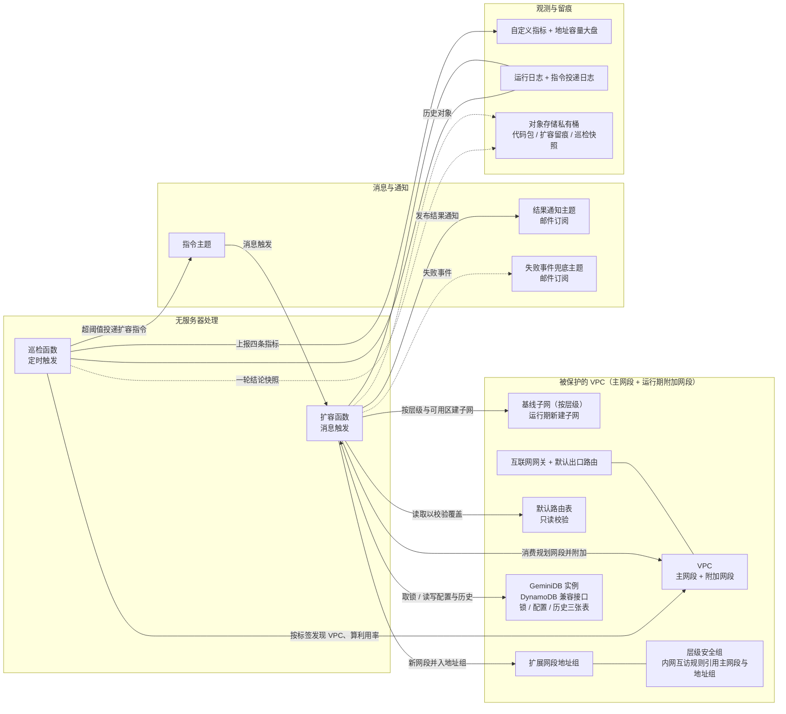

# VPC 地址容量自动化扩展实践

[](LICENSE)
[](https://www.huaweicloud.com)

## 简介

本实践在华为云上搭建一条「地址容量巡检 → 超阈值投递扩容指令 → 自动扩展网段与子网 → 结果通知与留痕」
的闭环链路，让 VPC 在地址耗尽之前就被自动补上新的地址空间。

手工管理 VPC 地址通常会遇到三件事：一是没人定期去算还剩多少可用地址，往往是业务报「建不出实例」
才发现网段满了；二是附加网段之后还要逐个层级建子网、改安全组允许的地址范围，步骤多且容易漏；
三是扩容这类写操作一旦并发执行就可能互相踩到同一地址空间。本实践用两个无服务器函数取代这套人工流程：

1. **容量可视化**：巡检函数按标签发现被纳管的 VPC，读取主网段、附加网段与全部子网现状，算出地址
   利用率、可用地址、总容量与子网数四条自定义指标，落到自定义监控命名空间并接入大盘。
2. **按规划扩展**：利用率达到触发线后，巡检函数向指令主题投递一条扩容指令；扩容函数消费指令，
   先判断现有地址空间是否装得下全层级铺开，装不下才按外部地址规划逐个校验重叠、消费下一个网段，
   把它附加到 VPC，再按层级在每个可用区建子网。
3. **改完即通**：华为云安全组绑定到端口而非子网，本实践让各层级安全组的内网互访规则引用一个地址组，
   新网段进入地址组即刻对所有层级生效；默认路由表作为只读对象做生效校验。
4. **同一 VPC 串行**：扩容函数在状态存储里按 VPC 取一把带过期时间的锁，配合并发上限与投递静默窗口，
   保证同一个 VPC 同时只有一次扩展在跑。
5. **结果可追**：每次执行在历史表落一行权威台账，并向结果主题发布一封含每个新建子网名、网段、
   可用区与标识的通知邮件，同时在对象存储留一份可读快照。

适用于：

- 在华为云上维护多套 VPC、需要把地址扩容从人工操作变成自动化流程的网络与应用运维人员；
- 希望用一套 Terraform 栈落一条可观测、可复现、可销毁的自动化网络运维链路，又不想常驻自建服务的团队；
- 需要参考「定时巡检 + 消息触发 + 函数内轮询 + 分布式锁 + 双写留痕」这一套无服务器工程写法的读者。

## 目录

- [目录结构](#目录结构)
- [架构图](#架构图)
- [方案亮点](#方案亮点)
- [涉及云服务](#涉及云服务)
- [前置条件](#前置条件)
- [快速开始](#快速开始)
- [分步部署](#分步部署)
- [参数表](#参数表)
- [使用方法与验证](#使用方法与验证)
- [清理资源](#清理资源)
- [详细说明](#详细说明)
- [故障排除](#故障排除)
- [许可证](#许可证)
- [联系方式](#联系方式)

## 目录结构

```text
.
├── docs/
│   ├── architecture.md              组件、数据流、网段与层级规划模型、锁与幂等、失败语义、取舍
│   └── deployment-guide.md          从零到可验证部署的分步命令与每步预期输出
├── infra/
│   ├── versions.tf                  Terraform 与 Provider 版本约束
│   ├── providers.tf                 Provider 配置
│   ├── variables.tf                 部署参数与校验（共 63 项）
│   ├── locals.tf                    层级发现、函数运行期配置下发、指标与大盘清单
│   ├── vpc.tf                       被保护的 VPC、基线子网、公网出口、状态存储实例
│   ├── network.tf                   默认路由表引用、扩展网段地址组、层级安全组与规则
│   ├── functions.tf                 代码包桶、两个函数、两类触发器、异步失败兜底
│   ├── monitoring.tf                三条主题、两条邮件订阅、地址容量大盘
│   ├── lts.tf                       日志组、三条日志流、指令投递日志
│   ├── iam.tf                       函数运行委托、加密主密钥
│   ├── outputs.tf                   对外输出
│   └── terraform.tfvars.example     参数样例（全部为占位符）
├── src/
│   └── functions/
│       ├── shared/                  两个函数共用的模块
│       │   ├── net_plan.py          网段几何、空闲块分配、命名序号、利用率口径
│       │   ├── state_store.py       状态存储客户端：建表与三类读写
│       │   ├── ddb_signer.py        状态存储接口的请求签名
│       │   ├── hw_cloud_api.py      网络与消息侧的读写收口
│       │   ├── hw_signer.py         云服务 API 的请求签名
│       │   ├── hw_transport.py      带超时与重试上限的传输层
│       │   ├── history_writer.py    历史表行与对象快照的写入
│       │   ├── invocation.py        事件信封解包、运行凭据、执行编号
│       │   └── handler_errors.py    异常分层（决定是否值得重试）
│       ├── monitor/                 巡检函数
│       │   ├── index.py             入口与一轮巡检的编排
│       │   ├── monitor_conf.py      运行期配置读取与阈值约束
│       │   ├── inspector.py         按标签发现 VPC、算观测值、给规划视角
│       │   ├── metrics.py           四条自定义指标的组装与分块上报
│       │   ├── dispatcher.py        判定是否投递指令、观测写回、投递静默窗口
│       │   └── snapshot.py          一轮巡检的快照对象
│       ├── expansion/               扩容函数
│       │   ├── index.py             入口：装配、取锁、收尾（放锁 → 通知 → 抛出）
│       │   ├── runtime_conf.py      运行期配置与层级规划对象
│       │   ├── expansion_flow.py    一次扩容的顺序执行体
│       │   ├── expansion_lock.py    按 VPC 的分布式锁（取、查、放）
│       │   └── notify_text.py       通知标题与正文文案
│       ├── build_packages.py        代码包构建脚本（两个包，拍平到 zip 根目录）
│       ├── build/                   构建产物目录（执行构建脚本后生成代码包）
│       └── tests/                   离线单元测试（395 条用例，云端交互全部由替身接管）
├── .gitignore
├── README.md
├── README.en.md
└── LICENSE
```

## 架构图



数据流分六段，逐段对应仓库里的实现：

| 段落 | 实现位置 | 做了什么 |
|-|-|-|
| 发现与观测 | `src/functions/monitor/inspector.py` | 列出项目内 VPC，按 `MonitorCIDR=true` 标签筛出纳管对象；用主网段 + 附加网段与子网余量算出利用率、可用地址、总容量、子网数 |
| 指标与大盘 | `src/functions/monitor/metrics.py`、`infra/locals.tf`、`infra/monitoring.tf` | 四条序列上报到自定义命名空间 `vpc_cidr_expansion.custom`，维度名 `VpcId`；大盘按同一命名空间与指标名取数 |
| 触发决策 | `src/functions/monitor/dispatcher.py` | 利用率达到触发线、地址规划未用尽且不在 1800 秒静默窗口内时，向指令主题投递 `{vpc_id, reason, utilization}` |
| 地址扩展 | `src/functions/expansion/expansion_flow.py`、`src/functions/shared/net_plan.py` | 判断现有空间是否够用；不够则消费规划里下一个网段并轮询生效，再按层级在每个可用区切空闲段建子网 |
| 网段联动 | `infra/network.tf`、`expansion_flow._ensure_address_group` | 新网段写入地址组，各层级安全组引用该地址组的入站规则即刻覆盖新地址空间；默认路由表只读校验生效 |
| 串行与留痕 | `expansion_lock.py`、`history_writer.py`、`notify_text.py`、`infra/monitoring.tf` | 按 VPC 取锁与放锁、历史表落台账、桶内落快照对象、结果主题发通知 |

## 方案亮点

- **阈值判定在代码里，不在人工经验里**：触发线（默认 85%）与扩容侧二次校验下限（默认 80%）由部署参数
  显式下发，两个函数共用同一套利用率口径（每个子网扣除 3 个保留地址），一条链路里不会出现两个「利用率」。
- **规划驱动的网段消费**：附加网段来自 `planned_secondary_cidrs` 这份按优先级排序的外部规划，消费前
  逐个校验与主网段、已附加网段、现有子网的重叠，被跳过的条目连同原因一起留痕。
- **一次调用跑完整条链路**：取锁 → 附加网段 → 轮询生效 → 建子网 → 网段联动 → 写台账 → 发通知 → 放锁
  收敛在扩容函数的一次调用内，分支与等待都在代码里显式表达，不需要常驻编排服务。
- **写操作不盲目重发**：附加网段与建子网超时后结果未知，函数一律先回读事实状态（轮询附加结果、按名称
  确认子网是否已建出来）再决定下一步，避免「同一网段附加两次」「同名子网重复创建」。
- **子网重试预算整段共享**：重试次数与间隔（默认 3 × 30 秒）算出的预算由整段子网创建共用而非每子网各一份，
  预算耗尽即停止等待并把剩余子网记为失败，保证链路一定产出可用部分与一份完整台账。
- **同一 VPC 串行化**：扩容函数并发上限压到 1，配合状态表里按 VPC 的条件写锁与持有者校验放锁，
  重复投递、人工投递与异步重投都只会有一次真实扩展落地。
- **改完即通，不需要逐条改安全组**：各层级安全组的内网互访规则引用一个地址组，新网段进地址组即全层级生效；
  华为云每 VPC 默认一张路由表的约束下，网段路由交给平台自动维护，函数只读校验。
- **运行期状态不被部署回滚**：附加网段、地址组成员、默认路由下一跳、基线子网标签、巡检周期与启停这五处
  以运行期事实为准，后续 `terraform apply` 不会把平台的或函数的改动改回去。
- **失败不静默**：函数执行失败时平台的异步调用配置会把事件投到兜底主题并邮件通知；台账写不进、通知发不出、
  放锁失败都会明确留在结果与日志里。
- **离线可验证**：395 条单元测试不联网，部署前即可跑完整条链路的判定分支；构建脚本只用标准库。

## 涉及云服务

| 服务 | 在本实践中的作用 | 对应资源 |
|-|-|-|
| 虚拟私有云 VPC | 被保护与被扩展的网络：主网段、运行期附加网段、纳管标签 | `huaweicloud_vpc` |
| VPC 子网 | 按层级的基线子网；扩容函数在运行期新建子网（不进本栈） | `huaweicloud_vpc_subnet` |
| VPC 路由 | 默认路由表（数据源只读引用）与 public 层级的默认出口路由 | `huaweicloud_vpc_route`、`data.huaweicloud_vpc_route_table` |
| 互联网网关 | VPC 的公网出口设备，与默认路由拆开声明 | `huaweicloud_vpc_internet_gateway` |
| 地址组 | 扩展网段集合，安全组规则引用的唯一可变集合 | `huaweicloud_vpc_address_group` |
| 安全组 | 每层级一个安全组，入站规则引用主网段与地址组 | `huaweicloud_networking_secgroup`、`huaweicloud_networking_secgroup_rule` |
| GeminiDB（DynamoDB 兼容接口） | 锁、每 VPC 配置、扩容历史三张表的状态存储；表由函数首启创建 | `huaweicloud_geminidb_instance` |
| 函数工作台 FunctionGraph | 巡检函数与扩容函数、定时与消息触发器、异步失败兜底 | `huaweicloud_fgs_function`、`huaweicloud_fgs_trigger`、`huaweicloud_fgs_async_invoke_configuration` |
| 对象存储服务 OBS | 代码包与留痕对象的私有桶：匿名访问阻断、强制 HTTPS、按前缀过期 | `huaweicloud_obs_bucket`、`huaweicloud_obs_bucket_bpa`、`huaweicloud_obs_bucket_policy`、`huaweicloud_obs_bucket_object` |
| 消息通知服务 SMN | 指令通道、结果通知、失败事件兜底三条主题与邮件订阅、投递日志 | `huaweicloud_smn_topic`、`huaweicloud_smn_subscription`、`huaweicloud_smn_logtank` |
| 云日志服务 LTS | 两个函数各自的运行日志流、指令投递留痕流 | `huaweicloud_lts_group`、`huaweicloud_lts_stream` |
| 云监控服务 CES | 四条自定义指标的命名空间与地址容量大盘 | `huaweicloud_ces_dashboard`、`huaweicloud_ces_dashboard_widget` |
| 密钥管理服务 KMS | 加密代码包与留痕对象的客户托管主密钥，开启轮转 | `huaweicloud_kms_key` |
| 统一身份认证 IAM 委托 | 函数运行期以临时凭据访问网络、存储、消息、监控与状态存储 | `huaweicloud_identity_agency` |

本栈共声明 35 个资源与 2 个数据源。实践使用完毕后请及时释放资源、避免残留，销毁命令见
[清理资源](#清理资源)。

## 前置条件

### 账号与权限

- 华为云账号已完成实名认证，所在区域具备 VPC、GeminiDB、FunctionGraph、OBS、SMN、LTS、CES、KMS 的
  开通与创建权限。
- 执行部署的身份需要能在统一身份认证里**创建委托**：本栈要创建一个信任函数图服务
  （`op_svc_cff`）的委托，全局服务级角色放 `OBS Administrator`、`KMS CMK Decrypter`，
  项目级角色放 `VPC FullAccess`、`FunctionGraph FullAccess`、`SMN FullAccess`、`CES FullAccess`、
  `GeminiDB FullAccess`、`LTS FullAccess`。角色放错作用域会出现「委托创建成功但调用被拒」。
- 访问密钥：在华为云控制台「服务与支持 → 我的凭证 → 我的访问密钥」页面获取访问密钥 ID 与秘密访问密钥，
  配置到执行 Terraform 的环境里（`HW_ACCESS_KEY`、`HW_SECRET_KEY`，使用临时安全令牌时另加
  `HW_SECURITY_TOKEN`）；不要把密钥写进代码、`terraform.tfvars` 或提交到仓库。
- 函数运行期不持有任何长期密钥：凭据只从调用上下文取委托签发的临时三元组。

### 两条必须先确认的硬前提

1. **状态存储的规格码与接口版本必须按目标区域实查后填入。**
   `geminidb_spec_code` 与 `geminidb_engine_version` 在本栈里**没有可用默认值**（示例参数文件写作
   `<GEMINIDB_SPEC_CODE>` / `<GEMINIDB_DDB_INTERFACE_VERSION>`）。请用控制台「GeminiDB → 购买」的实例规格列表
   按所选区域与可用区实查「接口版本 + 规格码 + 存储类型」的真实可创建组合，替换后再执行 `terraform apply`；
   沿用占位值会在创建实例这一步失败。只读数据源 `huaweicloud_geminidb_configuration_datastores` 可用来核对
   区域内「接口类型 + 实例形态 + 版本」是否成组可用；`huaweicloud_geminidb_available_flavors` 需要传入
   一个已存在实例的标识，回答的是「这台实例还能改成哪些规格」，不适合首次部署前的规格实查。本栈固定 `datastore.type = "DynamoDB"`、
   `storage_engine = "rocksDB"`，实例形态 `geminidb_instance_mode` 默认 `Cluster`、节点数默认 3、
   单节点存储默认 100 GB、存储类型默认 `ultra`。
2. **`notification_email` 必须是真实可收信的邮箱。** SMN 邮件订阅资源在服务侧校验端点格式，且订阅创建后
   需要在收到的确认邮件里点击确认，否则结果通知与失败事件都不会投递。占位符会让订阅创建失败。

### 其它准备

- Terraform `>= 1.5`，huaweicloud Provider `~> 1.96.1`（约束见 `infra/versions.tf`）。
- Python 3.9 及以上，用于跑离线单元测试与构建代码包；构建脚本只依赖标准库。
- 两个函数的代码包必须在 `terraform plan` / `apply` 之前构建：`huaweicloud_obs_bucket_object` 的 `source`
  指向 `../src/functions/build/cidr-monitor.zip` 与 `cidr-expansion.zip`，文件不存在时 plan 直接报读文件失败。
- 地址规划前提：`planned_secondary_cidrs` 里每个候选网段都必须与 `vpc_cidr` 及现有子网不重叠；函数在消费前
  会再校验一次，重叠或格式非法的条目会被跳过并留痕。
- 网段数量与容量上限：单个 VPC 承载的网段总数上限由 `secondary_cidr_max_count`（默认 8）控制，
  地址组成员容量上限由 `expansion_address_group_capacity`（默认 20）控制，两者都会在服务端校验前被函数拦下。
- 区域约束：默认区域 `cn-north-4`，可用区 `cn-north-4a / 4b / 4c`。改用其它区域时须同步调整 `region`、
  `availability_zones`、`geminidb_availability_zones`、`baseline_subnets` 里的 `az` 字段，
  并重新实查上面第一条硬前提的取值。
- 网络前提：状态存储只暴露 VPC 内私有地址，因此两个函数都挂进被保护的 VPC，函数子网取
  `function_subnet_name`（默认 `svc-private-1`，属于不参与扩展的层级），避免扩容链路的消费方
  与它自己占用的地址空间互相挤兑。

## 快速开始

以下命令在本仓库根目录执行；`cd infra` 之后的命令均在 `infra/` 目录内执行。

```bash
# 1) 先构建两个函数代码包（apply 会读取这两个文件，缺失则报路径不存在）
python src/functions/build_packages.py

# 2) 准备部署参数，替换全部占位符（见下文参数表与部署指导）
cd infra
copy terraform.tfvars.example terraform.tfvars    # Windows
# cp terraform.tfvars.example terraform.tfvars    # Linux/macOS

# 3) 初始化、静态校验、执行部署
terraform init
terraform validate
terraform plan
terraform apply
```

`terraform validate` 预期输出为 `Success! The configuration is valid.`。
`terraform plan` 末尾为 `Plan: 35 to add, 0 to change, 0 to destroy.`。
`terraform apply` 完成后会打印 26 个输出项，其中包括 `vpc_id`、`vpc_main_cidr`、`default_route_table_id`、
`expansion_address_group_id`、`tier_security_group_ids`、`baseline_subnet_ids`、`internet_gateway_id`、
`expansion_tier_plan`、`monitor_function_urn`、`expansion_function_urn`、`commands_topic_urn`、
`notifications_topic_urn`、`dead_letter_topic_urn`、`monitor_cron`、`function_subnet_id`、`log_group_id`、
`assets_bucket`、`history_object_prefix`、`state_store_endpoint`、`state_store_port`、`state_store_tables`、
`kms_key_id`、`agency_name`、`monitor_env_keys`、`expansion_env_keys`、`dashboard_name`，
按 [使用方法与验证](#使用方法与验证) 逐条核对。

## 分步部署

完整分步说明（含每一步预期输出与实查方法）见 [docs/deployment-guide.md](docs/deployment-guide.md)，概览如下：

| 步骤 | 动作 | 关键命令或文件 | 预期结果 |
|-|-|-|-|
| 1 | 构建两个函数代码包 | `python src/functions/build_packages.py` | 打印两个包的路径、字节数与校验值，并列出包内条目 |
| 2 | 填写参数、替换占位符、实查规格 | `infra/terraform.tfvars.example` → `terraform.tfvars` | `notification_email`、`geminidb_spec_code`、`geminidb_engine_version`、`geminidb_password` 均为真实值 |
| 3 | 建立全部基础设施 | `terraform init` / `validate` / `plan` / `apply` | `Plan: 35 to add, 0 to change, 0 to destroy.`，随后 `Apply complete!` 并打印 26 个输出项 |
| 4 | 确认状态存储三张表就绪 | 首轮巡检与首条扩容指令自动建表 | `<前缀>-config` 由巡检函数创建，`<前缀>-locks` 与 `<前缀>-history` 由扩容函数创建 |
| 5 | 确认观测链路 | 手工测试一次巡检函数 | 返回 `monitored_count >= 1`，CES 自定义命名空间出现四条序列，大盘有数据 |
| 6 | 端到端跑一次扩容 | 向指令主题发布一条含 `vpc_id` 的消息 | 收到 `[SUCCESS] VPC CIDR Expansion - <账号> (cn-north-4)` 邮件，正文逐个列出新建子网 |
| 7 | 释放资源 | `terraform destroy` | 本栈声明的 35 个资源全部销毁，无残留 |

### 函数运行配置项

两个函数的运行配置由 `infra/locals.tf` 的 `monitor_user_data` 与 `expansion_user_data` 下发，键名即函数代码
读取的环境变量名，改键名等于改接口契约。可用 `terraform output monitor_env_keys` 与
`terraform output expansion_env_keys` 导出完整清单。

**两个函数共用**：`HW_REGION`、`HW_PROJECT_ID`、`HW_ACCOUNT_ID`、`DDB_ENDPOINT`、`DDB_PORT`、
`DDB_USER_NAME`、`DDB_PASSWORD`、`CONFIG_TABLE_NAME`、`OBS_BUCKET`、`OBS_ENDPOINT`、
`SECONDARY_CIDR_PLAN`、`WARNING_THRESHOLD`。

| 巡检函数专有键 | 取值来源 | 说明 |
|-|-|-|
| `MONITOR_TAG_KEY` / `MONITOR_TAG_VALUE` | `var.monitor_tag_key` / `var.monitor_tag_value` | 纳管筛选条件，默认 `MonitorCIDR=true` |
| `UTILIZATION_THRESHOLD` | `var.utilization_threshold` | 触发扩容的利用率（百分比），必须不低于 `WARNING_THRESHOLD` |
| `CES_NAMESPACE` / `CES_DIMENSION_NAME` | `var.ces_metric_namespace` / `var.metric_dimension_name` | 指标命名空间与维度名，必须与大盘取数一致 |
| `COMMAND_TOPIC_URN` | 指令主题 URN | 超阈值时投递扩容指令的目标 |

| 扩容函数专有键 | 取值来源 | 说明 |
|-|-|-|
| `LOCK_TABLE_NAME` / `HISTORY_TABLE_NAME` | `locals` 生成的表名 | 与 `CONFIG_TABLE_NAME` 三张表都不在 Terraform 里声明，由函数首启创建 |
| `TARGET_VPC_ID` | `huaweicloud_vpc.main.id` | 指令指向的 VPC 与之不符时直接跳过，不动任何资源 |
| `TIER_PLAN` | `locals.tier_plan` | 参与扩展的层级：层名、样例子网名、可用区集合、掩码、安全组标识 |
| `CIDR_MAX_COUNT` / `SUBNET_NETMASK` | `var.secondary_cidr_max_count` / `var.expansion_subnet_netmask` | 网段总数上限与扩容子网默认前缀长度 |
| `ADDRESS_GROUP_ID` | `huaweicloud_vpc_address_group.expansion.id` | 新网段写入它即完成全层级安全组联动 |
| `DEFAULT_ROUTE_TABLE_ID` | `data.huaweicloud_vpc_route_table.default.id` | 只读校验新网段是否已被路由覆盖，函数不写路由 |
| `NOTIFICATION_TOPIC_URN` | 结果通知主题 URN | 成功、部分成功、失败三种状态发通知 |
| `HISTORY_OBJECT_PREFIX` | `locals.history_object_prefix` | 留痕对象在桶内的前缀，生命周期规则按同一前缀清理 |
| `LOCK_TTL_SECONDS` / `POLL_INTERVAL_SECONDS` / `POLL_DEADLINE_SECONDS` | `var.lock_ttl_seconds` 等 | 锁过期时间、附加网段轮询间隔与总时长上限 |
| `SUBNET_RETRY_ATTEMPTS` / `SUBNET_RETRY_INTERVAL` | `var.subnet_retry_attempts` / `var.subnet_retry_interval_seconds` | 整段共享的子网重试预算（两者相乘） |

## 参数表

下表列出必须替换或强烈建议按自己的环境复核的参数；**全部 63 项参数的类型、默认值与逐项说明**
见 [docs/deployment-guide.md](docs/deployment-guide.md) 的参数表章节。

| 变量 | 类型 | 默认值 | 必填 | 说明 |
|-|-|-|-|-|
| `region` | string | `cn-north-4` | 否 | 部署区域，本实践在该区域验证 |
| `name_prefix` | string | `vpc-cidr-expansion` | 否 | 全部资源名与表名的统一前缀 |
| `enterprise_project_id` | string | `0` | 否 | 企业项目 ID，`0` 为默认企业项目 |
| `vpc_cidr` | string | `10.0.0.0/16` | 否 | VPC 主网段 |
| `availability_zones` | list(string) | `cn-north-4a/4b/4c` | 否 | 本实践使用的可用区 |
| `baseline_subnets` | list(object) | 7 条基线子网 | 复核 | 子网名、网段、可用区、层级 `tier` 与是否参与扩展 `expandable`；层级名决定安全组名 |
| `function_subnet_name` | string | `svc-private-1` | 否 | 函数接入 VPC 使用的基线子网名 |
| `planned_secondary_cidrs` | list(string) | `["10.1.0.0/16","10.2.0.0/16"]` | 复核 | 外部地址规划，按优先级排序，逐个消费 |
| `secondary_cidr_max_count` | number | `8` | 否 | 单 VPC 网段总数上限（主网段 + 附加网段） |
| `expansion_subnet_netmask` | number | `24` | 否 | 扩容子网默认前缀长度；函数优先沿用同层已有子网掩码 |
| `expansion_address_group_capacity` | number | `20` | 否 | 地址组容量上限 |
| `public_egress_enabled` | bool | `true` | 否 | 是否声明互联网网关与默认出口路由 |
| `monitor_tag_key` / `monitor_tag_value` | string | `MonitorCIDR` / `true` | 否 | 纳管标签，巡检函数按它发现对象 |
| `utilization_threshold` | number | `85` | 复核 | 触发扩容的利用率（百分比） |
| `warning_threshold` | number | `80` | 复核 | 扩容侧二次校验下限，低于它则不动任何资源 |
| `monitor_cron` | string | `0 */5 * * * ?` | 否 | 巡检定时表达式，6 段 Cron（秒 分 时 日 月 周） |
| `trigger_enabled` | bool | `true` | 否 | 首次创建时定时触发器是否启用；创建后的启停由运行期决定 |
| `function_runtime` | string | `Python3.9` | 否 | 两个函数的运行时 |
| `monitor_handler` / `expansion_handler` | string | `index.main_handler` | 否 | 入口，要求代码包根目录存在 `index.py` 并定义 `main_handler` |
| `monitor_package` / `expansion_package` | string | `../src/functions/build/*.zip` | 否 | 代码包本地路径，必须与构建脚本产物路径逐字一致 |
| `monitor_memory_size` / `monitor_timeout` / `monitor_max_instances` | number / number / string | `256` / `300` / `"5"` | 否 | 巡检函数规格；超时需覆盖一轮全部纳管 VPC 的扫描 |
| `expansion_memory_size` / `expansion_timeout` / `expansion_max_instances` | number / number / string | `256` / `900` / `"1"` | 复核 | 扩容函数规格；超时须大于「轮询上限 + 子网重试预算 + 收尾余量」 |
| `lock_ttl_seconds` | number | `900` | 否 | 锁过期时间，进程异常退出后由它自愈 |
| `association_poll_interval_seconds` / `association_poll_deadline_seconds` | number | `10` / `600` | 否 | 附加网段生效的轮询间隔与总时长上限 |
| `subnet_retry_attempts` / `subnet_retry_interval_seconds` | number | `3` / `30` | 否 | 子网创建的重试次数与间隔，乘积是整段共享的重试预算 |
| `async_retry_attempts` / `async_event_max_age_seconds` | number | `2` / `3600` | 否 | 异步调用重试次数与事件最长存活时间 |
| `notification_email` | string | 无默认 | **是** | 结果通知与失败事件的收件邮箱；订阅需在邮件里确认 |
| `log_retention_days` / `history_retention_days` | number | `30` / `90` | 否 | 运行日志保留天数 / 留痕对象保留天数 |
| `ces_metric_namespace` | string | `vpc_cidr_expansion.custom` | 复核 | 必须是 `service.item` 格式：仅字母、数字与下划线，总长 3-32，禁连字符 |
| `metric_dimension_name` | string | `VpcId` | 否 | 指标维度名，函数按它以 VPC 标识上报 |
| `enable_dashboard` | bool | `true` | 否 | 是否创建地址容量大盘（含 4 个图件） |
| `dashboard_widget_view` / `dashboard_metric_display_mode` | string | `line` / `single` | 否 | 图件视图类型与指标展示方式 |
| `dashboard_dimension_filter_type` / `dashboard_dimension_value` | string | `all_instances` / `""` | 否 | 维度过滤方式；被纳管 VPC 在运行期才发现，默认取全部资源 |
| `dashboard_top_n` | number | `20` | 否 | 图件展示的序列条数上限 |
| `geminidb_spec_code` | string | 无默认 | **实查** | 状态存储实例规格码，须按目标区域实查后填入 |
| `geminidb_engine_version` | string | `3.0` | **实查** | DynamoDB 兼容接口版本，须与区域内已上架版本一致 |
| `geminidb_datastore_type` / `geminidb_storage_engine` | string | `DynamoDB` / `rocksDB` | 否 | 接口类型与存储引擎 |
| `geminidb_instance_mode` / `geminidb_node_count` / `geminidb_volume_size` / `geminidb_volume_type` | string / number / number / string | `Cluster` / `3` / `100` / `ultra` | 否 | 实例形态与容量：节点数、单节点存储（GB）、存储类型 |
| `geminidb_availability_zones` | list(string) | `cn-north-4a/4b/4c` | 否 | 实例可用区，须为基线子网所在可用区的子集 |
| `geminidb_data_subnet_name` | string | `data-private-1` | 否 | 实例所在基线子网名 |
| `geminidb_password` | string（敏感） | 无默认 | **是** | 实例初始账号口令，同时作为函数侧 `DDB_PASSWORD` |
| `geminidb_charging_mode` | string | `postPaid` | 否 | 实例资源类型，取值 `postPaid` 或 `prePaid` |
| `agency_delegated_service_name` | string | `op_svc_cff` | 否 | 被委托方云服务标识 |
| `agency_domain_roles` / `agency_project_roles` | list(string) | 见上 | 否 | 全局服务级与项目级角色清单，角色名须与 IAM 权限列表一致 |
| `tags` | map(string) | `{ ManagedBy = "vpc-cidr-automation" }` | 否 | 统一附加到可标签化资源的标签 |

四处取值最容易踩坑：`notification_email`、`geminidb_spec_code`、`geminidb_engine_version`、
`geminidb_password`（后两项必须实查，第四项必须由你自备强口令）。`baseline_subnets` 与
`planned_secondary_cidrs` 决定这条链路扩什么、扩到哪，建议按自己的地址规划改写而不是沿用默认。

## 使用方法与验证

### 离线验证（部署前即可做，不联网）

```bash
python -m pytest src/functions -q
```

预期输出末行统计为 395 条用例全部通过（耗时随机器略有差异）：

```text
........................................................................ [ 91%]
...................................                                      [100%]
395 passed in 0.41s
```

覆盖范围包括：网段几何与空闲块分配、命名序号推进、利用率与余量口径、每 VPC 配置覆盖生效与非法覆盖
直接失败、CIDR 规划的重叠校验与跳过留痕、附加网段的轮询与超时判定、地址组成员写入与容量越界、
路由覆盖判定（排除默认路由）、按 VPC 取锁与条件写竞态、持有者校验放锁与 TTL 自愈、
子网整段共享重试预算与预算耗尽后的剩余记失败、超时后按名称回读避免重复创建、
台账写失败不回滚已改动资源、通知文案与主题标题的纯 ASCII 约束、巡检侧四类指标组装与分块上报、
投递静默窗口与四种跳过状态、事件信封三种形态的归一、委托临时凭据缺失即失败、状态存储协议与签名。

构建代码包并核对清单：

```bash
python src/functions/build_packages.py
```

预期输出首部（两个包各一段，字节数与校验值随源码变更）：

```text
monitor -> src/functions/build/cidr-monitor.zip (47240 bytes)
  sha256: 221df7380e6da87e2eca9e3fd066b3462ce21ac3691c2c73eb95e45b7d0af234
  - ddb_signer.py
  - handler_errors.py
  ...
```

清单里的包路径与 `var.monitor_package` / `var.expansion_package` 的默认值、
`huaweicloud_obs_bucket_object` 的 `source` 完全一致。包内条目是两个函数共用模块与各自源码目录的
`.py` 文件拍平到 zip 根目录，不含 `tests/`、`build/` 与构建脚本自身；`index.py` 必须在根目录，
入口契约 `index.main_handler` 由构建脚本在打包前静态校验。只想构建一个包：
`python src/functions/build_packages.py monitor` 或 `expansion`。

### 部署后最简示例：手工触发一轮巡检

1. 取输出项：`terraform output monitor_function_urn`、`terraform output vpc_id`、
   `terraform output state_store_tables`。
2. 在函数控制台选中巡检函数，用「同步测试」传入下面这份事件（函数不依赖事件内容，只为日志标记来源）：

   ```json
   { "trigger_type": "TIMER" }
   ```

3. 预期返回形如（字段名与 `src/functions/monitor/index.py` 一致）：

   ```json
   {
     "execution_id": "1f2e3d4c...",
     "trigger": "TIMER",
     "monitored_count": 1,
     "observed": 1,
     "observe_failed": 0,
     "metrics_reported": { "samples": 4, "batches": 1, "failed_batches": 0 },
     "decision_counts": { "below_threshold": 1 },
     "decisions": [ { "vpc_id": "<vpc_id>", "utilization": 3.16, "next_cidr": "10.1.0.0/16",
                      "dispatched": false, "reason": "below_threshold" } ],
     "threshold": 85.0,
     "dispatches": [],
     "snapshot": { "written": true, "key": "cidr-monitor-snapshot/<日期>/<执行编号>.json" }
   }
   ```

   刚部署完的地址几乎没有被占用，`reason` 为 `below_threshold` 属预期结论。`monitored_count` 至少为 1
   是因为本栈给 VPC 打了 `MonitorCIDR=true` 标签。
4. 到云监控控制台自定义命名空间 `vpc_cidr_expansion.custom`、维度 `VpcId` 下确认四条序列
   `UtilizationPercentage`、`AvailableIPs`、`TotalCapacity`、`SubnetCount` 都已出现数据；
   大盘 `<name_prefix>-capacity` 的四个图件随之有曲线。

### 端到端动手练习：跑完整条扩容链路

下面这条路径把「指令投递 → 取锁 → 附加网段 → 建子网 → 网段联动 → 台账 → 通知」全部走一遍，
不需要先把地址用满。在 `infra/` 目录执行第 1 步，其余在控制台完成。

1. **确认栈下发的规划与定位**（`infra/` 目录）：

   ```bash
   terraform output expansion_tier_plan
   terraform output vpc_id
   terraform output commands_topic_urn
   terraform output notifications_topic_urn
   terraform output state_store_tables
   ```

   预期分别打印三个参与扩展的层级（`public`、`private`、`ops`，各自的可用区集合与掩码 24）、
   VPC 标识、两条主题 URN，以及三张表名 `<前缀>-locks` / `<前缀>-config` / `<前缀>-history`。

2. **确认订阅已确认**：在 `notification_email` 邮箱里点击 SMN 的确认邮件；未确认时通知不会投递。

3. **构造一条扩容指令**（仓库根目录执行，只依赖标准库）：

   ```bash
   python -c "import json;print(json.dumps({'vpc_id':'<把 output vpc_id 的值贴在这里>','reason':'manual-drill','utilization':92.0},ensure_ascii=False))"
   ```

   输出形如 `{"vpc_id": "xxx", "reason": "manual-drill", "utilization": 92.0}`。

4. **发布到指令主题**：在 SMN 控制台选中 `<前缀>-commands` 主题，「发布消息」时把上一步输出的 JSON 作为
   消息正文，主题名即触发源。扩容函数由消息触发器唤起并异步执行。

   `utilization` 传 92.0 的意义：扩容侧只把「巡检算好的利用率」作为二次校验输入，
   传入高于 `warning_threshold`（默认 80）的值即可让链路真正动手，而不必先把地址耗尽。
   需要观察「消费规划网段」这一步时，把地址收紧：把 `vpc_cidr` 改成一个装不下全层级铺开的小网段
   （例如 `10.0.0.0/21` 并把 `baseline_subnets` 的 7 条子网放进该网段），重新 apply 后再投递一次指令，
   此时空闲地址小于一次全层级铺开所需的 1280 个地址，函数会消费规划里的第一个网段。

5. **查看这一次执行的返回结果**（函数控制台「执行结果」），字段与 `expansion_flow.run()` 一致：

   ```json
   {
     "status": "SUCCESS",
     "vpc_id": "<vpc_id>",
     "vpc_name": "vpc-cidr-expansion-vpc",
     "execution_id": "1f2e3d4c...",
     "mode": "secondary_cidr",
     "new_cidr": "10.1.0.0/16",
     "utilization": 92.0,
     "required_addresses": 1280,
     "cidr_count_after": 2,
     "subnet_retry_budget_seconds": 90,
     "subnet_retry_used_seconds": 0,
     "subnets_created": [ { "tier": "public", "name": "vpc-cidr-expansion-public-3",
                             "cidr": "10.0.7.0/24", "availability_zone": "cn-north-4a",
                             "gateway_ip": "10.0.7.1", "id": "<子网标识>" } ],
     "subnets_failed": [],
     "address_group": { "updated": false, "reason": "已是成员" },
     "route_check": { "checked": true, "covered": true, "matched": "10.1.0.0/16" },
     "history_table": "vpc-cidr-expansion-history",
     "history_written": true,
     "lock": { "released": true, "reason": "released" }
   }
   ```

   `address_group.updated` 为 `false`、`reason` 为「已是成员」是默认参数下的正常结论：地址组在部署期就
   把全部规划网段纳入，运行期只是确认成员关系；若你把地址组改为只放已启用网段，这里会变成
   `{"updated": true, ...}`，通知正文相应打印「已追加新网段」。

6. **查收通知邮件**：标题为 `[SUCCESS] VPC CIDR Expansion - <账号> (cn-north-4)`，正文由
   `src/functions/expansion/notify_text.py` 拼装，逐个列出每个新建子网的名称、网段、可用区与标识：

   ```text
   VPC 网段自动扩容 - 成功

   账号               <账号ID>
   区域               cn-north-4
   VPC              <vpc_id> (vpc-cidr-expansion-vpc)
   触发原因             manual-drill
   触发利用率            92.0%
   判定阈值             80.0%
   扩展方式             消费规划网段后铺开子网
   新增附加网段           是 (10.1.0.0/16)
   子网创建数            5
       - vpc-cidr-expansion-public-3  10.0.7.0/24  cn-north-4a (<子网标识>)
       - vpc-cidr-expansion-public-4  10.1.0.0/24  cn-north-4b (<子网标识>)
       - vpc-cidr-expansion-app-private-3  10.1.1.0/24  cn-north-4a (<子网标识>)
       - vpc-cidr-expansion-app-private-4  10.1.2.0/24  cn-north-4b (<子网标识>)
       - vpc-cidr-expansion-ops-private-2  10.1.3.0/24  cn-north-4a (<子网标识>)
   地址组联动            已是成员
   路由覆盖             已覆盖 (10.1.0.0/16)
   网段数量             1 -> 2
   扩容后可用地址          65280

   执行编号: 1f2e3d4c...
   耗时: 41s
   留痕: 表 vpc-cidr-expansion-history：已写入；对象 expansion-history/<vpc_id>/<时间>-<执行编号>.json
   ```

   「扩容后可用地址」取扩容后再读一次的现状；若某些子网的余量字段读不到，该行打印 `unknown`，
   与代码口径一致。「留痕」行的对象部分也可能是「对象未落：<原因>」——快照对象是旁路，不影响本次结论。

7. **确认地址与控制台现状一致**：VPC 详情页应出现附加网段 `10.1.0.0/16`；子网列表里出现新建子网，
   标签带 `ManagedBy=sample-automated-vpc-cidr-expansion`、`Tier=<层级>`、`ExpansionExecution=<执行编号>`、
   `ExpansionCidr=<网段>`；默认路由表出现覆盖新网段的网段路由（由平台自动维护）。

8. **验证串行与幂等护栏**：
   - 连续投递两条指令（执行编号不同），第二条的返回状态是 `SKIPPED_LOCK_BUSY`，不动任何资源；
   - 把消息里的 `vpc_id` 换成另一个 VPC 标识，返回 `SKIPPED_TARGET_MISMATCH`，同样不动任何资源；
   - 把 `utilization` 改成 50（低于 `warning_threshold`），返回 `SKIPPED_BELOW_THRESHOLD`，
     这三种跳过状态都不发通知邮件，避免每个周期都寄一封；
   - 再投递一次同样的指令，函数不会重复附加同一个网段（`pick_plan_cidr` 会跳过已附加条目），
     新建子网按命名序号继续往后排。

9. **验证巡检侧自动触发**（可选）：把 `utilization_threshold` 临时降到当前利用率以下
   （例如 `5`）、同时把 `warning_threshold` 降到它以下（例如 `2`）后 `terraform apply`，
   等下一个巡检周期看指令主题出现一条消息、扩容函数被唤起。注意投递静默窗口是 1800 秒，
   同一 VPC 在半小时内只会投一条。验证完把两个阈值改回来。

10. **确认日志与留痕**：LTS 里 `<前缀>-monitor` 与 `<前缀>-expansion` 两条日志流分别记录两个函数的
    执行过程，`<前缀>-command-delivery` 记录指令投递；桶内 `expansion-history/<vpc_id>/` 下是历史对象、
    `cidr-monitor-snapshot/<日期>/` 下是每轮巡检快照；历史表 `<前缀>-history` 按 `vpc_id` + `timestamp`
    能查到本次执行的台账行。

> 部署完成后，请按本节步骤在真实环境里自行验证：确认巡检能发现被纳管 VPC 并上报指标、
> 指令投递与消费能跑完整条扩容链路、通知邮件确实到达你的邮箱、台账与快照确实落盘、
> 四类跳过护栏按预期生效。全部核对通过后，本实践才算在你环境中交付完成。

## 清理资源

在 `infra/` 目录执行：

```bash
cd infra
terraform destroy
```

确认后执行，预期输出末行为 `Destroy complete! Resources: N destroyed.`。

- 本栈声明的 35 个资源全部在销毁范围内：VPC、基线子网、互联网网关与默认出口路由、扩展网段地址组、
  层级安全组与全部入站规则、状态存储实例、代码包桶与桶内对象及策略、两个函数与两个触发器、
  两条异步失败兜底配置、三条主题与两条邮件订阅、投递日志配置、日志组与三条日志流、
  大盘与四个图件、加密主密钥、运行委托。
- 扩容函数在运行期创建的资源**不在 Terraform 状态里**，需要一并手工清理：新建的附加网段随 VPC 销毁，
  运行期新建的子网请在 VPC 删除前逐个删除，状态存储里的三张表随实例销毁，桶内留痕对象由
  `force_destroy` 随桶清空。
- 桶与对象设置了 `force_destroy = true`，生命周期规则也会在 `history_retention_days` 到期后清理留痕对象。
- 若个别资源因你在控制台手工关联了其它资源而删除失败，请清理该依赖后重跑 `terraform destroy`。
- 及时释放资源、避免残留；同时清理你在邮箱侧为本次验证添加的订阅确认与过滤规则。
- 本地构建产物 `src/functions/build/*.zip` 由构建脚本生成，可随时删除，重新构建即可复现。

## 详细说明

- [docs/architecture.md](docs/architecture.md)：组件清单与职责、数据流与调用时序、网段与层级规划模型、
  锁与幂等的具体语义、观测面、失败语义与运行期取舍。
- [docs/deployment-guide.md](docs/deployment-guide.md)：从零到可验证部署的分步命令、全部 63 项参数的
  类型与默认值、每步预期输出、排查与清理。
- [README.en.md](README.en.md)：本文件的英文版本，结构一致。

## 故障排除

| 现象 | 原因与处理 |
|-|-|
| `plan` 报读不到代码包文件 | `src/functions/build/` 下缺 `cidr-monitor.zip` 或 `cidr-expansion.zip`；先执行 `python src/functions/build_packages.py` 再 `plan` |
| apply 在状态存储实例上报规格不可用 | `geminidb_spec_code`、`geminidb_engine_version` 仍是占位取值或与区域内实际上架组合不符，先实查再替换 |
| apply 在邮件订阅上报端点非法 | `notification_email` 未填真实邮箱；SMN 订阅端点由服务侧校验 |
| apply 在自定义指标命名空间上报错 | `ces_metric_namespace` 不是 `service.item` 格式（含连字符、超长或段首非字母） |
| apply 在委托上报权限错误，函数运行期调用被拒 | 全局服务级角色与项目级角色放错了作用域：`OBS Administrator`、`KMS CMK Decrypter` 属全局服务级，其余在本栈放项目级 |
| 巡检返回 `monitored_count` 为 0 | 目标 VPC 没有 `MonitorCIDR=true` 标签，或标签值与 `monitor_tag_value` 不完全相等（按字符串比较，大小写敏感） |
| 巡检返回某 VPC 的 `utilization` 为 `null` | 子网余量字段读不到，函数不猜测数值：该 VPC 不投指令、`UtilizationPercentage` 序列也不上报；先查函数的网络接入与权限 |
| 大盘没有数据 | 命名空间、指标名、维度名三处必须与函数上报完全一致；`enable_dashboard` 是否为 `true`；`dashboard_dimension_filter_type` 选 `specific_instances` 时 `dashboard_dimension_value` 必须填真实 VPC 标识 |
| 扩容返回 `SKIPPED_BELOW_THRESHOLD` | 事件里的 `utilization`（或自行计算的利用率）低于 `warning_threshold`，属二次校验护栏；确认阈值或调整投递内容 |
| 扩容返回 `SKIPPED_TARGET_MISMATCH` | 指令里的 `vpc_id` 与函数绑定的 `TARGET_VPC_ID` 不一致；该函数的层级规划只对着本栈的 VPC 设计 |
| 扩容返回 `SKIPPED_LOCK_BUSY` | 同一 VPC 已有一次扩容在跑；`lock_ttl_seconds`（默认 900 秒）到期后锁自动可被再次取得 |
| 巡检一直不投指令 | 四条判定任一不满足：观测不可用、未达触发线、地址规划已用尽、距上次投递不足 1800 秒静默窗口 |
| 报「地址规划已用尽」 | `planned_secondary_cidrs` 里剩余候选都与主网段、已附加网段或现有子网重叠，或格式非法；补一个真正不重叠的网段并同步地址组容量 |
| 报网段数量触顶 | 已附加网段数达到 `secondary_cidr_max_count`（上限 20）；提高该参数需重新评估地址组容量与安全组暴露面 |
| 报地址组容量不足 | 结果里出现 `AddressGroupCapacityFull`：调高 `expansion_address_group_capacity` 后重新交付 |
| 附加网段轮询超时 | 结果里出现 `AssociationTimeout`，`waited_seconds` 到 `association_poll_deadline_seconds`（默认 600 秒）；先确认函数在 VPC 内可访问网络服务，再考虑放宽窗口 |
| 通知邮件收不到 | 邮件订阅未在确认邮件里点确认；结果主题 `users_publish_allowed` 必须为 `"true"`；函数日志里 `notification_failed` 会给出服务端返回 |
| 台账写失败但资源已改动 | 通知与结果里的 `留痕` 行会显示「写入失败」；函数不会因此回滚已附加的网段与已创建的子网，请按日志里的 `vpc_id` 与执行编号人工补录，并检查状态存储连通性与口令 |
| 后续 apply 把运行期改动改回去了 | 检查是否改动了本栈持有的字段。附加网段、地址组成员、默认路由下一跳、基线子网标签、巡检周期与启停这五处以运行期为准；函数名、规格、环境变量、并发上限、桶与主题配置、实例规格由本栈持有，必须显式改参数后 apply |
| 函数仍运行旧代码 | 重新构建包并 `terraform apply`；代码包对象变化会触发函数重建，云端才会取到新包 |

## 许可证

本实践采用 MIT No Attribution 许可证发布，详见 [LICENSE](LICENSE)。

## 联系方式

本实践由公有云持续运营部创建与维护。
