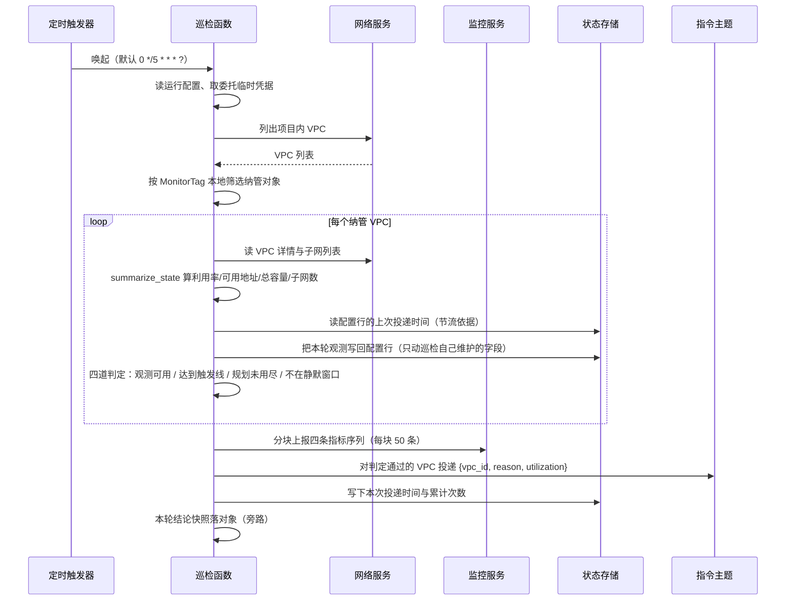
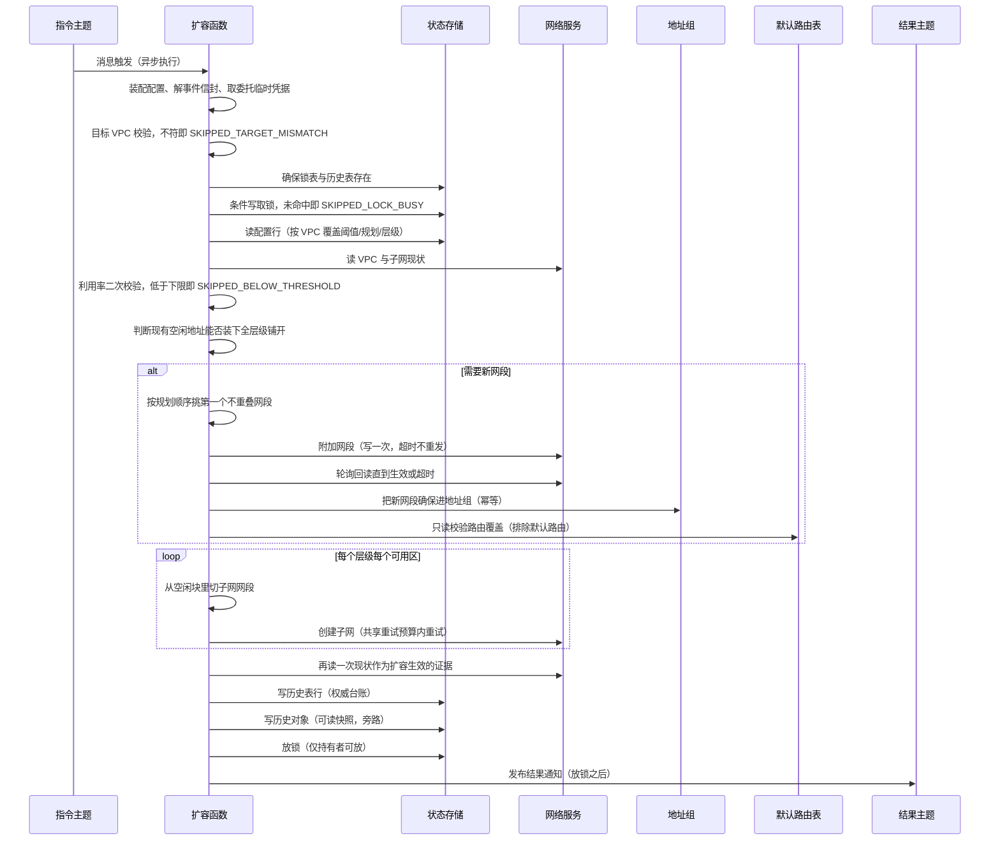

# 架构与技术设计

本文说明这套 VPC 地址容量自动化扩展实践由哪些部件组成、一次扩容如何被串起来、地址规划怎么建模、
并发与幂等如何保证、观测面在哪里、失败时系统的真实行为，以及几处刻意的运维取舍。
所有结论都来自本仓库 `infra/` 与 `src/functions/` 的实现，参数默认值取自 `infra/variables.tf`。

部署操作请看 [docs/deployment-guide.md](deployment-guide.md)，功能概览与验证步骤请看 [README.md](../README.md)。

## 目录

- [设计目标与约束](#设计目标与约束)
- [组件清单与职责](#组件清单与职责)
- [数据流与调用时序](#数据流与调用时序)
- [地址与层级规划模型](#地址与层级规划模型)
- [状态存储与三张表](#状态存储与三张表)
- [串行化与幂等](#串行化与幂等)
- [安全边界](#安全边界)
- [观测面](#观测面)
- [失败语义](#失败语义)
- [运行期事实与部署期望的边界](#运行期事实与部署期望的边界)
- [运维取舍](#运维取舍)
- [容量与边界值](#容量与边界值)

## 设计目标与约束

这条链路要解决的是三件事：地址耗尽前就补上新空间；补空间的多步骤动作不能靠人工逐项执行；
扩容这类写操作不能并发互相踩。由此定下四条设计约束，后面所有机制都能回溯到它们：

| 约束 | 采用的做法 | 落点 |
|-|-|-|
| 不常驻自建服务 | 两个无服务器函数：定时唤起巡检、消息唤起扩容；分支与等待都在函数代码里显式表达 | `src/functions/monitor/index.py`、`src/functions/expansion/index.py` |
| 不猜地址事实 | 每次执行都从云端读主网段、附加网段与全部子网现状，判断与收尾都以读到的事实为准 | `shared/hw_cloud_api.py`、`shared/net_plan.py:summarize_state` |
| 同一 VPC 一次只跑一个扩容 | 函数并发上限压到 1，状态表里按 VPC 取带过期时间的锁，巡检侧再加投递静默窗口 | `var.expansion_max_instances`、`expansion/expansion_lock.py`、`monitor/dispatcher.py` |
| 新网段立刻对内网互通生效 | 安全组入站规则引用一个地址组，函数把新网段写进地址组；默认路由表只作只读生效校验 | `infra/network.tf`、`expansion_flow._ensure_address_group`、`_route_check` |

链路形态是**规划驱动**的：附加网段不临时编造，只能从外部给出的有序规划里按顺序取，
取之前先与主网段、已附加网段、现有子网做重叠校验。这让"扩到哪"成为一件可以事先评审的事。

## 组件清单与职责

| 组件 | 承载资源 | 职责 | 生命周期由谁决定 |
|-|-|-|-|
| 被保护的 VPC | `huaweicloud_vpc.main` | 提供主网段与附加网段的承载体；带 `MonitorCIDR=true` 纳管标签 | 主网段与标签由本栈创建；附加网段由扩容函数在运行期追加 |
| 基线子网 | `huaweicloud_vpc_subnet.baseline`（默认 7 条） | 建立层级结构：层级名、掩码、可用区与所属安全组的发现载体 | 网段与可用区由本栈声明；标签的后续变化以云端为准 |
| 公网出口 | `huaweicloud_vpc_internet_gateway.main`、`huaweicloud_vpc_route.public_egress` | `public` 层级的默认出口路由 | 路由条目由本栈创建，下一跳以云端为准 |
| 默认路由表 | `data.huaweicloud_vpc_route_table.default` | 只读对象：函数用它校验新网段是否已被路由覆盖 | 平台随 VPC 创建，本栈只引用 |
| 扩展网段地址组 | `huaweicloud_vpc_address_group.expansion` | 安全组规则引用的唯一可变集合，承载"新网段是否进入内网互访允许范围" | 组本身与容量上限由本栈持有；成员集合随运行期消费进度变化 |
| 层级安全组与规则 | `huaweicloud_networking_secgroup.tier`、`huaweicloud_networking_secgroup_rule.*` | 每个层级一个安全组，入站规则分别引用主网段与地址组 | 全部由本栈持有 |
| 状态存储实例 | `huaweicloud_geminidb_instance.state_store` | 提供 VPC 内私有的 DynamoDB 兼容接口，承载锁、每 VPC 配置与扩容历史三类数据 | 实例与网络接入由本栈创建；三张表由函数首启创建 |
| 巡检函数 | `huaweicloud_fgs_function.monitor` + `huaweicloud_fgs_trigger.monitor_schedule` | 发现纳管对象、算观测值、上报四条指标、超阈值投递扩容指令 | 函数体由本栈持有；定时器的周期与启停以运行期为准 |
| 扩容函数 | `huaweicloud_fgs_function.expansion` + `huaweicloud_fgs_trigger.expansion_command` | 消费指令并跑完整条扩展链路 | 本栈持有 |
| 异步失败兜底 | `huaweicloud_fgs_async_invoke_configuration.*` | 函数执行失败时把事件投到兜底主题 | 本栈持有 |
| 三条主题与两条订阅 | `huaweicloud_smn_topic.*`、`huaweicloud_smn_subscription.*` | 指令通道、结果通知、失败事件；结果与兜底主题各挂一条邮件订阅 | 本栈持有 |
| 运行日志 | `huaweicloud_lts_group.runtime`、`huaweicloud_lts_stream.*` | 两个函数各自的日志流与指令投递留痕流 | 本栈持有 |
| 资产桶 | `huaweicloud_obs_bucket.assets` 及访问阻断、TLS 策略、委托授权策略 | 代码包载体与留痕对象载体 | 本栈持有 |
| 大盘 | `huaweicloud_ces_dashboard.capacity`、`huaweicloud_ces_dashboard_widget.capacity` | 四条指标各一个图件 | 本栈持有 |
| 加密主密钥 | `huaweicloud_kms_key.assets` | 桶内对象的服务端加密，开启轮转 | 本栈持有 |
| 运行委托 | `huaweicloud_identity_agency.functions` | 函数运行期取临时凭据访问网络、存储、消息、监控与状态存储 | 本栈持有 |

两个函数都以 `Python3.9` 运行时承载，入口契约是包根目录的 `index.main_handler`
（`var.monitor_handler` / `var.expansion_handler` 默认值），代码包由
`src/functions/build_packages.py` 构建后经桶对象交给函数。

## 数据流与调用时序

### 一轮巡检



时序上有三处容易误读，代码是这样处理的：

1. **标签筛选在本地完成**：列表接口返回的标签形态不唯一（字典或 `key/value` 数组），
   交回服务端过滤反而容易漏，因此 `inspector.matches_tag` 统一在函数内比较，值按字符串比较且大小写敏感。
2. **观测先于上报**：指标上报覆盖本轮全部判定对象的观测值，一条序列缺失（例如余量读不到导致利用率为
   `null`）只跳过那一条，其余三条照报，让大盘上"无数据"与"数据为 0"是两件可区分的事。
3. **投递后才写节流时间戳**：`record_dispatch` 在投递成功后落 `last_dispatch_at`。
   这一步失败不会撤回已经投出去的指令，下一轮可能重投一次，由扩容函数侧的锁兜底。

### 一次扩容



入口 `src/functions/expansion/index.py` 把收尾顺序固定为「放锁 → 发通知 → 抛出」：
先释放资源再对外发声，且放锁必须覆盖执行体抛出任何异常的情况，因此放锁与通知放在入口而不是放在
业务序列里（`expansion_flow.py` 的模块说明明确了这条边界）。

指令事件会被归一成同一个请求对象（`shared/invocation.py`）：直接调用、定时信封、消息信封三种形态
都能解出 `vpc_id` / `reason` / `utilization`，归一结果记录在结果的 `envelope` 字段里，便于排障时确认
"这条指令从哪儿来"。

## 地址与层级规划模型

### 三层规划输入

| 规划 | 来源参数 | 作用 |
|-|-|-|
| 主网段 | `var.vpc_cidr` | VPC 的地址基线，默认 `10.0.0.0/16` |
| 附加网段规划 | `var.planned_secondary_cidrs` | 有序候选清单，按优先级逐个消费，默认 `10.1.0.0/16`、`10.2.0.0/16` |
| 层级规划 | `var.baseline_subnets` 推导出的 `local.tier_plan` | 每个层级的样例子网名、可用区集合、掩码与安全组；只有 `expandable = true` 的层级参与扩展 |

默认参数下参与扩展的是 `public`（2 个可用区）、`private`（2 个可用区）与 `ops`（1 个可用区）三个层级，
掩码 `/24`；`data` 与 `svc` 两个层级不参与扩展——函数自身挂在与状态存储互通的 `svc-private-1`，
把它排除在扩展之外，链路的消费方与它占用的地址空间就不会互相挤兑。

### 两套地址口径（不可混用）

`shared/net_plan.py` 定义了两个不同的口径，各自服务一个判断，代码注释与本文都强调它们的差异：

| 口径 | 公式 | 用途 |
|-|-|-|
| 地址利用率 | `(子网地址总数 - 3 × 子网数 - 各子网剩余地址之和) / (子网地址总数 - 3 × 子网数)` | 触发扩容与二次校验。华为云每个子网保留 3 个地址（网段地址、网关地址、广播地址），常量 `RESERVED_IPS_PER_SUBNET = 3` 被两个函数共用，因此同一条链路里不会出现两个"利用率" |
| 空闲地址 | `网段地址总数之和 - 已被子网占用的地址总数`（不扣保留位） | 判断"现有空间装不装得下全层级铺开"。判断容量用整体空间更保守也更准确 |

利用率还有第二个前提：任何一个子网的剩余地址字段读不到时，`summarize_state` 把 `available_ips` 与
`utilization` 置为 `None` 并标记 `availability_known = false`——函数不猜测数值。巡检侧因此不投指令，
指标侧因此不报利用率那条序列。

### 需要性判断与一次铺开所需地址

`expansion_flow.run()` 用一行判定决定走哪条路径：

```text
mode = secondary_cidr  当  unallocated_addresses < required_addresses
       existing_space  否则
```

`required_addresses = Σ(层级可用区数 × 2^(32 - 层级掩码))`。默认规划是 `(2+2+1) × 256 = 1280` 个地址。
因此主网段为 `10.0.0.0/16` 时现有空间充裕，链路走 `existing_space`：不新增网段，只把子网铺开在空闲块上；
把主网段收紧到 `10.0.0.0/21` 之类的规模后，空闲地址不足 1280，才会真正消费规划网段。
这两条路径都会做地址组与路由校验吗？不会——`existing_space` 没有新增网段，结果里
`route_check` 与 `address_group` 都记为"本次未新增网段"，这是刻意保持的语义诚实。

### 规划网段的消费与跳过留痕

`pick_plan_cidr` 按规划顺序逐个校验，返回第一个可用网段以及被跳过条目与原因：

| 跳过原因 | 判定 |
|-|-|
| `already_associated` | 该网段已经在 VPC 的附加网段里——重复投递同一指令时不会产生第二次附加 |
| `invalid_format` | 字符串不是合法 IPv4 网段（按 `strict=True` 解析，主机位非零也算非法） |
| `overlaps_vpc_cidrs` | 与主网段或已附加网段重叠 |
| `overlaps_existing_subnets` | 与现有任一子网重叠 |

解析不了的网段一律视为不安全（`overlaps_any` 对无法解析的目标直接返回"重叠"）。
全部候选都被跳过时 `pick_plan_cidr` 返回 `None`，扩容侧抛 `PlanExhausted` 并把 `skipped` 清单带进
失败通知；巡检侧的 `plan_view` 同一时间也会把 `plan_exhausted` 记为真，因此正常情况下不会走到那一步。
跳过清单同时写进历史表行（`skipped_plan`），排障时能直接看出"规划里剩下的网段为什么不能用"。

### 空闲块切分与命名序号

子网网段不是按固定步长推出来的，而是从真实空闲块里切：

1. `free_blocks(cidrs, occupied)` 把每个网段减去已被子网占用的部分，得到按起始地址排序的空闲块列表；
   某个空闲块被占用完全覆盖时补集为空，实现里对 `address_exclude` 在"占用段等于或大于空闲块"时会抛异常
   的情况做了兜底，避免把已占满的地址段继续当成空闲空间。
2. `allocate_from_free(blocks, prefix)` 从第一个能容纳 `/prefix` 的块里切出候选，并把剩下的部分重新并入
   空闲列表；调用方在同一个列表上连续分配，因此同一轮里创建的多个子网不会互相重叠。
3. 掩码取层级的 `netmask`：由该层级样例子网的掩码推导，缺省时落回 `var.expansion_subnet_netmask`（默认 24），
   并受 `[8, 28]` 区间约束——华为云子网前缀长度不得大于 28。
4. `occupied` 列表在每次创建成功后追加实际网段，因此"云端现状 + 本轮已建"共同决定下一个子网的位置。
5. 名称由 `next_names` 延续既有命名序号：样例名 `vpc-cidr-expansion-public-2` 在同层级现有名字里找最大序号，
   续出 `-3`、`-4`，并按样例的零填充宽度对齐；样例名不含数字时退化为追加 `-1/-2`。
   名称超过 64 字符（华为云子网名上限）时不发起创建，直接记为一条失败项。

`tier.security_group_id` 只用于留痕与通知：华为云安全组绑定到端口而非子网，新建子网不需要、
也无法在这里绑定安全组，新网段的内网互访由地址组成员承载。同理，创建子网时 DNS 与 DHCP 参数
从同层级样例子网继承（`_baseline`）：委托未授予云解析读权限，函数无法查询区域默认解析地址，
找不到基线时全部留空，由 VPC 侧套用区域默认值。

### 按 VPC 覆盖规划

配置表里每个 VPC 一行，三个字段 `warning_threshold` / `secondary_cidrs` / `tiers` 是"按 VPC 定制"的载体：
运维手工写入、扩容函数读取。读取与生效规则是：

- 表不存在或该行读不到不是故障：回落到部署栈下发的环境变量规划，结果里 `plan_source` 记为 `environment`。
- 阈值只在 `(0, 100]` 区间内生效；规划清单接受字符串或数组形态；层级清单非法时**直接失败**而不是
  静默回落——否则"按 VPC 定制"这件事不可信。
- 生效时 `plan_source` 记为 `config_table(字段名)`，通知、日志与台账都能看到本次用的是哪份规划。
- 巡检函数只写自己维护的观测字段，永远不改这三个字段；写入前有一道守护，多写一个字段就拒绝写入。

## 状态存储与三张表

状态存储是 GeminiDB 实例对外提供的 DynamoDB 兼容接口，只暴露 VPC 内私有地址，因此两个函数都挂进被保护的
VPC 才能读写。函数侧只使用该接口明确支持的 `DescribeTable` / `CreateTable` / `PutItem` / `GetItem` /
`UpdateItem` 五个动作，不使用事务、备份等该接口不支持的能力；请求走 JSON 协议并按接口要求签名，
签名用的账号口令即实例的数据库账号（`DDB_USER_NAME` / `DDB_PASSWORD`）。

| 表 | 键结构 | 谁创建 | 谁写 | 谁读 | 内容 |
|-|-|-|-|-|-|
| `<前缀>-locks` | 分区键 `vpc_id` | 扩容函数（首启，取锁前） | 扩容函数 | 扩容函数 | 锁持有者、状态、绝对过期时间、加解锁时间、请求方 |
| `<前缀>-config` | 分区键 `vpc_id` | 巡检函数（每轮首步确保存在） | 巡检函数写观测字段；运维手工写覆盖字段 | 两个函数：巡检读节流时间戳，扩容读按 VPC 覆盖规划 | 观测值、下一个网段、规划是否用尽、投递时间与次数、可选的三个覆盖字段 |
| `<前缀>-history` | 分区键 `vpc_id` + 排序键 `timestamp` | 扩容函数（尽力而为，建表失败不阻断扩容） | 扩容函数 | 排障与后续巡检 | 每次扩容一行的权威台账 |

**三张表都不在 Terraform 里声明**：部署栈交付的是实例与网络接入，表由函数首次运行时按需创建
（`ensure_table`：`DescribeTable` 廉价探测，缺失即 `CreateTable`，接口侧 DDL 同步、创建后无需等待激活）。
这样做的结果是 `terraform plan` 里看不到它们，也不会因为表被删除而让部署失败；代价是表结构属于函数，
改表结构要改代码而不是改参数。

表按需创建还解决一个时序问题：第一条扩容指令完全可能先于首次巡检到达，
所以扩容函数在取锁前也会把锁表与历史表确保存在（`expansion_flow.ensure_tables`），
锁表建不出来才报错，历史表建不出来只记警告。

读请求带重试（读 2 次、超时 10 或 15 秒），写请求一律不自动重试（写 0 次）；
`ConditionalCheckFailedException` 被翻译成"条件未命中"这一业务语义而不是故障，
否则取锁竞争会被误判成链路失败。

## 串行化与幂等

### 锁

| 动作 | 语义 |
|-|-|
| `check` | 只读判定：没有记录、状态不是 `LOCKED`、或 `lock_ttl` 已到（或不可解析）都视为未占用；持有中返回 `held_until_<时间戳>` |
| `acquire` | 先 `check`，被他人持有即抛 `LockUnavailable`；再以条件写落锁，条件为"记录不存在，或状态不是 LOCKED，或 TTL 已过期"。条件未命中同样抛 `LockUnavailable`——那是与 `check` 之间的正常竞态，不是故障 |
| `release` | 条件 `lock_holder = 本次执行`，只有持有者放得动；放锁失败**不抛异常**，返回 `holder_mismatch` 或 `state_store_error` |

两处细节值得注意。**锁过期不依赖接口的 TTL 能力**：写入的是绝对秒级时间戳，读取时与当前时间比较，
因为该兼容接口不保证与 DynamoDB 一致的 TTL 行为。**放锁失败不能把整次执行判成失败**：资源已经改动，
锁由 `var.lock_ttl_seconds`（默认 900 秒）自然自愈，下一轮取得到锁即可继续。

三道闸门叠加保证"同一 VPC 同时只有一次真实扩展"：函数并发上限 1（`expansion_max_instances`）、
VPC 级条件写锁、巡检侧 1800 秒投递静默窗口（`DISPATCH_COOLDOWN_SECONDS`，取值必须覆盖扩容函数
900 秒超时上限的整次执行）。窗口用巡检自己写下的 `last_dispatch_at` 计算，因为锁表不在巡检函数的配置里；
时间戳解析不了时按"从未投递"处理——窗口失效的后果只是多投一条指令，锁会兜住。

### 幂等

链路上每个动作都设计成"重复执行不产生第二份事实"：

| 动作 | 幂等手段 |
|-|-|
| 附加网段 | 挑网段时跳过已附加条目；写请求超时或拿到冲突类响应后不重发，转为轮询回读事实状态 |
| 创建子网 | 超时后先按名称回读，命中即当作创建成功；名称由 `next_names` 延续序号，重复执行不会撞名 |
| 写地址组 | 成员已含目标网段时返回"已是成员"不做写入；写入报错后回读一次，成员确实存在则视为已生效 |
| 建表 | `DescribeTable` 命中即跳过，进程内再做一次缓存去重 |
| 取锁 | 条件写；同一执行重复调用不会误放他人的锁 |
| 通知 | 无幂等键，但跳过类状态一律不发（`NOTIFIED_STATUSES` 只含成功、部分成功、失败），避免每个周期寄信 |
| 巡检观测写回 | 字段级 `SET`，绝不做整行覆盖，因此不会擦掉运维写的覆盖规划 |

写操作"结果未知时先回读"是这条链路最重要的一条纪律：附加网段与创建子网都是写操作，
超时后盲目重发会造成同一网段附加两次或同名子网重复创建，实现把两者都收口为"读事实再决定"。

## 安全边界

- **函数不持有长期密钥**：运行期凭据只从调用上下文的委托临时三元组取；取不到即失败，
  本地联调可用环境变量凭据兜底，日志会显式标注凭据来源（值不打印）。
- **委托角色分作用域**：`OBS Administrator`、`KMS CMK Decrypter` 属全局服务级，
  `VPC FullAccess`、`FunctionGraph FullAccess`、`SMN FullAccess`、`CES FullAccess`、
  `GeminiDB FullAccess`、`LTS FullAccess` 属项目级；放错作用域会出现"委托创建成功但调用被拒"。
- **桶侧最小授权**：匿名访问阻断、强制 HTTPS 策略、只授予委托主体 `GetObject` / `PutObject` / `ListBucket`，
  留痕模块只追加对象，不读也不改桶配置。
- **加密**：桶内对象由客户托管 KMS 密钥服务端加密，密钥开启轮转。
- **状态存储只在 VPC 内可达**：接口在 VPC 内以明文 HTTP 提供（实例侧另有 SSL 开关），
  函数接入的层级不参与扩展，避免自挤兑。
- **输出面不含凭据**：日志、指标、通知与历史对象都走"不含凭据"的配置视图通道
  （`describe()`），字段清单是显式列举的，不存在"整个配置字典直接打印"的路径。

## 观测面

### 指标与大盘

| 指标名 | 单位 | 大盘图件 |
|-|-|-|
| `UtilizationPercentage` | `Percent` | 地址利用率 |
| `AvailableIPs` | `Count` | 可用地址数 |
| `TotalCapacity` | `Count` | 地址总容量 |
| `SubnetCount` | `Count` | 子网数量 |

命名空间 `vpc_cidr_expansion.custom`、维度名 `VpcId`（维度值为 VPC 标识）三处必须与函数上报完全一致，
`src/functions/monitor/metrics.py` 的常量与 `infra/locals.tf` 的 `local.metric_names` 逐字对齐——改名等于把
大盘打空。单次请求最多携带 50 条序列，超出分块发送，避免纳管对象偏多时被服务端截断。
被纳管 VPC 在运行期由标签发现、部署期无法枚举其 ID，因此大盘默认按"该维度下全部资源"展示。

### 日志与留痕

| 观测面 | 位置 | 看什么 |
|-|-|-|
| 函数运行日志 | LTS 流 `<前缀>-monitor` / `<前缀>-expansion` | 每轮的 `monitor_begin` / `monitor_round` 结论行；每次扩容的 `expansion_begin`、`extend_cidr_associated`、`address_group_updated`、`subnet_retry_budget_exhausted`、`expansion_done` 等关键事件 |
| 指令投递留痕 | LTS 流 `<前缀>-commands` + SMN 投递日志 | 一条指令从主题到函数调用的投递记录 |
| 权威台账 | 表 `<前缀>-history`，按 `vpc_id` + `timestamp` 查 | 状态、模式、消费的网段、掩码、创建与失败的子网清单、跳过规划清单、地址组与路由结果、扩容前后状态、层级规划、阈值来源、耗时与函数标识 |
| 可读快照 | 桶内 `expansion-history/<vpc_id>/<时间>-<执行编号>.json` | 表行内容加运行期配置视图；按 `var.history_retention_days`（默认 90 天）自动过期 |
| 巡检快照 | 桶内 `cidr-monitor-snapshot/<日期>/<执行编号>.json` | 一轮巡检的完整结论，包含每个 VPC 的判定与原因 |
| 邮件 | 结果主题与兜底主题各一条订阅 | 成功正文逐个列出新建子网的名称、网段、可用区与标识；失败正文列出错误类型、现场字段、已创建的子网与已附加的网段 |
| 死信 | 兜底主题 `<前缀>-dead-letter` | 函数执行失败时由平台异步配置投递，是控制台看到"这次失败"的唯一平台机制 |

## 失败语义

### 分层：读可重试，写不盲目重试

| 异常类 | 含义 | 是否值得平台重投 |
|-|-|-|
| `ConfigError` | 运行参数缺失或自相矛盾（含轮询总时长小于间隔这类矛盾） | 否；但实践仍让平台按异步配置重试一次，重试期间人工修好配置即可自愈 |
| `TransportError` | 请求没拿到响应，**结果未知** | 读操作可重试；写操作一律改由后续轮询步骤确认事实状态 |
| `ServiceError` | 云服务返回非 2xx，带状态码与请求编号 | 按状态码判定（429 与 5xx 可重试，其余不重试）；4xx（除 408/409/429）立即失败，等待不会变好 |
| `StateStoreError` | 状态存储侧读写失败 | 与传输层同类处理；条件未命中不算失败 |
| `LockUnavailable` | 同一 VPC 已有扩容在执行 | 否：转成 `SKIPPED_LOCK_BUSY` 返回，不抛异常、不发通知 |
| `PlanExhausted` | 规划用尽或网段数量触顶 | 否：需要改规划或参数，重投不会变好 |
| `AssociationTimeout` | 附加网段在轮询窗口内未生效 | 是：等待窗口是运维可调参数 |
| `PartialExpansion` | 一个子网都没建出来 | 否：抛异常触发失败通知与死信，现场结果挂在异常上 |

### 故障点与系统真实行为

| 故障点 | 系统反应 | 是否回滚已改动的资源 | 运维要看什么 |
|-|-|-|-|
| 巡检发现阶段失败（VPC 列表读不到） | 整轮无结论，异常原样抛出 → 平台投死信并发失败通知 | 不涉及 | 委托权限与函数网络接入 |
| 单个 VPC 观测失败 | 只影响该 VPC：它的观测带 `error`，本轮其余对象照常处理；计数出现在结果与快照里 | 不涉及 | 该 VPC 的读取权限与状态 |
| 子网余量读不到 | 利用率与可用地址记为 `None`：不投指令、不报利用率序列、不猜测 | 不涉及 | 网络侧字段可读性 |
| 观测写回 / 指标上报 / 快照落盘失败 | 都不改变本轮结论，只记日志（`failed_batches`、`snapshot` 的 `written=false`） | 不涉及 | 它们是展示面与旁路，不是判定依据 |
| 指令指向的 VPC 与函数绑定不符 | `SKIPPED_TARGET_MISMATCH`，不动任何资源、不发通知 | 不涉及 | 指令主题被复用或人工投错对象 |
| 二次校验低于阈值 | `SKIPPED_BELOW_THRESHOLD`，不动任何资源、不发通知 | 不涉及 | 阈值配置或投递内容 |
| 锁被占用 | `SKIPPED_LOCK_BUSY`，不动任何资源、不发通知 | 不涉及 | 前一次执行是否仍在跑；`lock_ttl_seconds` 到期即可重取 |
| 附加网段超时未生效 | 抛 `AssociationTimeout`，结果带 `waited_seconds` 与网段 | 不回滚已经发出的写请求（可能已在服务端生效） | 轮询窗口参数与函数网络接入 |
| 部分子网创建失败 | 状态 `PARTIAL_SUCCESS`，失败清单逐项带层级、名称、网段、可用区、尝试次数与原因 | 已附加网段与已成功子网保留 | `subnets_failed` |
| 子网重试预算耗尽 | 停止等待，剩余子网一次性记为失败，链路继续收尾 | 不 | `subnet_retry_used_seconds` 与 `subnet_retry_budget_seconds` |
| 全部子网创建失败 | 状态 `FAILED`，抛 `PartialExpansion`：结果（含已附加网段）挂在异常上 → 失败通知带现场 → 死信 | 已附加网段保留，不回滚 | 失败原因清单 |
| 历史表写失败 | 通知与结果的"留痕"行显示写入失败，日志记 `history_missing` | **不回滚**：附加的网段与创建的子网都是已经改变的事实，把整次执行判成失败反而掩盖真相 | 按 `vpc_id` 与执行编号人工补录；检查状态存储连通性与口令 |
| 通知发布失败 | 日志 `notification_failed` 带服务端返回，执行结论不变 | 不 | 通知是旁路，不能把一次已完成的扩容（或一次真实故障）改写结论 |
| 放锁失败 | 返回 `released=false` 与原因（`holder_mismatch` / `state_store_error`），不抛异常 | 不 | 锁由 TTL 自愈 |
| 留痕对象写失败 | 结果里 `history_object.written=false` 并带原因；运行时缺内置对象模块也只是记警告 | 不 | 对象快照是"人读的旁路" |

一句话概括这条链路的失败口径：**凡是已经写进云端的事实都不回滚，凡是旁路（通知、快照对象、指标、
观测写回）都不改变结论，凡是能让运维看清现场的字段都尽力带进结果、日志与通知。**

## 运行期事实与部署期望的边界

链路上有五处字段的真实值由运行期决定，而不是由部署声明决定。理解这一点是理解这套实践可运维性的关键：
后续执行 `terraform apply` 时，这五处不会被改回部署时声明的值，平台侧或函数侧的改动得以保留。

| 字段 | 承载对象 | 为什么以运行期为准 |
|-|-|-|
| 附加网段 | VPC | 由扩容函数按消费进度追加；若以声明值为准，下一次部署会把已扩展出去的地址空间撤掉，正在使用的实例立刻失去所属网段 |
| 地址组成员 | 扩展网段地址组 | 由扩容函数按消费进度增删；若以声明值为准，运行期调整过的成员会被改回，新地址空间会立刻被安全组规则拒之门外 |
| 默认出口路由的下一跳 | `public` 层级路由 | 下一跳可能已在控制台侧改指向别的设备；以运行期为准避免部署把流量切回旧设备 |
| 基线子网标签 | 基线子网 | 标签常被用于运行期的分组与筛选；保留云端值不会让一次部署覆盖掉别人加的标记 |
| 定时器的周期与启停 | 巡检触发器 | 临时停用巡检或调整周期是常见运维动作；以运行期为准，部署不会悄悄把它重新打开 |

其余对象——函数名与规格、环境变量、并发上限、代码包、桶与主题配置、实例规格、安全组规则、大盘与密钥
——都由本栈持有并期望与声明一致：需要改变时请显式修改参数后 `terraform apply`，
不要在控制台直接改，否则改动会被下一次部署覆盖。

## 运维取舍

| 取舍 | 换来什么 | 代价 | 需要改变时怎么做 |
|-|-|-|-|
| 编排逻辑写在函数里，不引入外部编排服务 | 无常驻组件、无额外权限面，一次调用产出一次完整结论 | 时序参数必须与函数超时自洽：轮询上限 600 秒 + 子网重试预算 + 收尾余量都要小于 `expansion_timeout`（默认 900 秒） | 改这三个参数并保持不等式成立；`terraform validate` 不会替你验证这条不等式 |
| 子网重试预算整段共享，而非每子网各一份 | 链路一定在超时前跑完收尾：放锁、写台账、发通知都不会被进程回收打断 | 靠后的层级可能因预算耗尽被记为失败，需要再投递一次补齐 | 调高 `subnet_retry_attempts` / `subnet_retry_interval_seconds`，同时调高 `expansion_timeout` |
| 地址组在部署期就纳入全部规划网段 | 消除"网段已附加但还没进地址组"的访问缺口，扩容时无需等待规则生效 | 安全组在网段真正启用前就允许该地址空间的入站互访 | 把 `infra/network.tf` 的 `addresses` 改为空集合，此时运行期写入变成真正的追加动作，通知里从"已是成员"变为"已追加新网段" |
| 路由表只读校验，函数不写路由 | 符合华为云每 VPC 默认一张路由表、网段路由由平台自动维护的形态，链路少一类写风险 | 校验是软信号，`covered=false` 不阻断扩容 | 若需要强约束，把结果里的 `route_check.covered` 纳入验收标准（本实践刻意只做观测） |
| 网段来源限定为外部规划，函数不自造网段 | "扩到哪"可事先评审，重复执行可预期 | 规划填错或全部重叠时链路会明确报"地址规划已用尽"而不是自动兜底 | 维护 `planned_secondary_cidrs`，或在配置表里按 VPC 写 `secondary_cidrs` |
| 巡检与扩容共用一个利用率口径 | 同一条链路里不会出现两个"利用率"，阈值可解释 | 保留地址数被固定为每个子网 3 个，口径调整需要同时改两处读取 | 修改 `RESERVED_IPS_PER_SUBNET` 常量并同步阈值预期 |
| 表结构属于函数而非部署栈 | 表按需创建，删除表不影响部署，第一条指令早到也不会失败 | 表结构变更要改代码而不是改参数 | 见 `shared/state_store.py` 的 `key_schema` 与两张表的字段清单 |
| 跳过类状态不发通知 | 每个巡检周期不会累积成一封封无效邮件 | 静默失败需要靠日志与巡检结论发现 | 观察 `monitor_round` 结论行的 `decision_counts` |

## 容量与边界值

| 边界 | 取值来源 | 默认 | 越界时的行为 |
|-|-|-|-|
| 单 VPC 网段总数上限 | `var.secondary_cidr_max_count`（运行期键 `CIDR_MAX_COUNT`，可配区间 1..20） | 8 | 达到上限时抛 `PlanExhausted`，带 `cidr_count` 与 `max_count` |
| 子网前缀长度区间 | `runtime_conf` 常量 | 8..28 | 层级掩码越界直接报配置错误；分配阶段越界的候选块返回"无法切出" |
| 地址组成员容量 | `var.expansion_address_group_capacity` | 20 | 新增成员将超容量时抛服务错误 `AddressGroupCapacityFull`，需调高参数后重新交付 |
| 子网名称长度 | 实现常量 | 64 字符 | 超长不发起创建，直接记为一条失败项 |
| 单次指标请求条数 | `metrics.BATCH_SIZE` | 50 | 分块上报，块失败计入 `failed_batches` 且不改变本轮结论 |
| 投递静默窗口 | `dispatcher.DISPATCH_COOLDOWN_SECONDS` | 1800 秒 | 窗口内不重复投递，判定原因 `within_cooldown` |
| 锁过期时间 | `var.lock_ttl_seconds`（下限 60 秒） | 900 秒 | 到期后锁可被再次取得，异常退出由此自愈 |
| 附加网段轮询窗口 | `association_poll_interval_seconds` × `association_poll_deadline_seconds` | 10 秒 / 600 秒 | 窗口内未生效抛 `AssociationTimeout` |
| 函数超时 | `var.monitor_timeout` / `var.expansion_timeout` | 300 秒 / 900 秒 | 超时由平台终止执行；本实践的时序参数都以"不触及超时"为前提选取 |
| 留痕对象保留期 | `var.history_retention_days` | 90 天 | 生命周期规则按前缀过期清理 |
